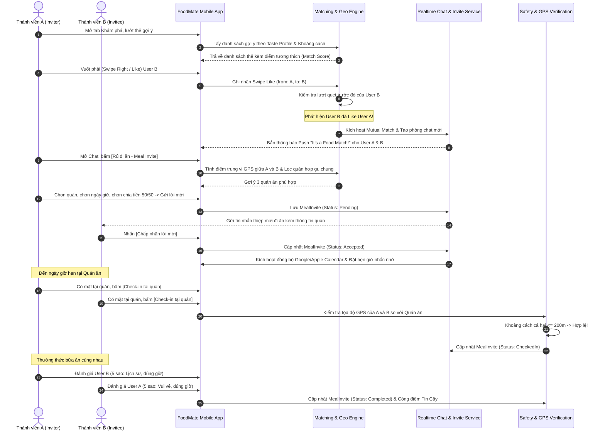

# TÀI LIỆU ĐẶC TẢ YÊU CẦU PHẦN MỀM (SRS)
## DỰ ÁN: FOODMATE – NỀN TẢNG KẾT NỐI ẨM THỰC & HẸN ĂN UỐNG THEO GU
**Phiên bản:** 1.0 (Phát hành chính thức cho đội ngũ Phát triển & Kiểm thử)  
**Tiêu chuẩn áp dụng:** IEEE/ISO/IEC 29148:2018 (Systems and software engineering — Life cycle processes — Requirements engineering)  
**Tác giả:** Business Analyst & Requirements Architect Team (Chuẩn `srs-writer` skill)  
**Trạng thái:** Sẵn sàng triển khai phát triển (Approved for Engineering)  
**Ngày phát hành:** 16/10/2026  

---

## MỤC LỤC
1. [Phần 1: Giới Thiệu Dự Án & Phạm Vi Hệ Thống](#phần-1-giới-thiệu-dự-án--phạm-vi-hệ-thống)
2. [Phần 2: Đối Tượng Người Dùng & Ma Trận Phân Quyền (RBAC)](#phần-2-đối-tượng-người-dùng--ma-trận-phân-quyền-rbac)
3. [Phần 3: Các Module Chức Năng Chi Tiết (Functional Requirements)](#phần-3-các-module-chức-năng-chi-tiết-functional-requirements)
4. [Phần 4: Danh Mục Dữ Liệu Nền Tảng (Master Data)](#phần-4-danh-mục-dữ-liệu-nền-tảng-master-data)
5. [Phần 5: Quản Lý Trạng Thái Nghiệp Vụ (Status State Machines)](#phần-5-quản-lý-trạng-thái-nghiệp-vụ-status-state-machines)
6. [Phần 6: Quy Tắc Nghiệp Vụ Phức Tạp (Business Rules & Decision Tables)](#phần-6-quy-tắc-nghiệp-vụ-phức-tạp-business-rules--decision-tables)
7. [Phần 7: Đặc Tả Use Case Chi Tiết (Use Case Specifications)](#phần-7-đặc-tả-use-case-chi-tiết-use-case-specifications)
8. [Phần 8: Từ Điển Dữ Liệu Doanh Nghiệp (Enterprise Data Dictionary Tóm Lược)](#phần-8-từ-điển-dữ-liệu-doanh-nghiệp-enterprise-data-dictionary-tóm-lược)
9. [Phần 9: Đề Xuất Màn Hình Danh Sách & Bộ Lọc Giao Diện Quản Trị (Admin Portal)](#phần-9-đề-xuất-màn-hình-danh-sách--bộ-lọc-giao-diện-quản-trị-admin-portal)
10. [Phần 10: Quy Trình Nghiệp Vụ Điển Hình (End-to-End Workflows)](#phần-10-quy-trình-nghiệp-vụ-điển-hình-end-to-end-workflows)
11. [Phần 11: Yêu Cầu Phi Chức Năng Nghiệp Vụ (Non-Functional Requirements - FURPS+)](#phần-11-yêu-cầu-phi-chức-năng-nghiệp-vụ-non-functional-requirements---furps)
12. [Phần 12: Lộ Trình Phát Triển (Phasing Plan) & Ma Trận Truy Vết (RTM)](#phần-12-lộ-trình-phát-triển-phasing-plan--ma-trận-truy-vết-rtm)

---

## PHẦN 1: GIỚI THIỆU DỰ ÁN & PHẠM VI HỆ THỐNG

### 1.1 Tổng Quan Dự Án
**FoodMate** là nền tảng di động đầu tiên tại Việt Nam giải quyết bài toán kết nối xã hội chuyên sâu qua lăng kính ẩm thực: *"Ăn ngon hơn khi có bạn cùng bàn"*. Định vị sản phẩm không đơn thuần là một ứng dụng hẹn hò hay một danh bạ nhà hàng, mà là chiếc cầu nối an toàn, tự nhiên và tin cậy đưa người dùng từ **khẩu vị tương đồng trực tuyến (online Taste Profile)** đến **trải nghiệm bàn ăn thực tế (offline dining experience)**.

### 1.2 Bối Cảnh & Vấn Đề Cốt Lõi Cần Giải Quyết
1. **Nỗi cô đơn ẩm thực đô thị**: Hơn 60% người trẻ (18–35 tuổi), bao gồm sinh viên xa nhà, người mới nhập cư và dân văn phòng phải ăn một mình; ngại đến các quán ăn gia đình, lẩu nướng đông đúc vì thiếu người đồng hành hợp gu.
2. **Khoảng trống của ứng dụng hẹn hò truyền thống**: Các ứng dụng như Tinder, Bumble tập trung nặng vào ngoại hình, tạo áp lực hẹn hò lãng mạn cao, thiếu chiều sâu sở thích ẩm thực cụ thể (chế độ ăn kiêng, dị ứng, mức độ ăn cay, ngân sách bữa ăn).
3. **Sự phân mảnh thông tin**: Dữ liệu quán ăn và công thức nấu nướng phân tán trên Facebook Groups, TikTok, Google Maps; thiếu tính tương tác trực tiếp với những người có chung khẩu vị.
4. **Rào cản an toàn khi gặp người lạ**: Người dùng e ngại rủi ro lừa đảo, quấy rối hoặc bùng hẹn khi tự rủ người lạ qua mạng xã hội do thiếu cơ chế xác thực danh tính và hỗ trợ an toàn.

### 1.3 Mục Tiêu Dự Án (Project Objectives)
- **Về Sản phẩm**: Rút ngắn thời gian từ lúc mở ứng dụng đến khi tìm được bạn ăn phù hợp xuống dưới 5 phút; quy trình từ lúc ghép đôi (Match) đến lúc chốt lịch hẹn đi ăn (Meal Invite) dưới 5 thao tác chạm.
- **Về Kinh doanh**: Đạt 50.000 người dùng tích cực (Active Users) trong 12 tháng đầu tại 2 thị trường trọng điểm: TP. Hồ Chí Minh và Hà Nội.
- **Về Cộng đồng**: Xây dựng tối thiểu 10.000 địa điểm quán ăn được xác thực và 5.000 công thức nấu ăn do người dùng tự đóng góp trong năm đầu.
- **Về An toàn**: Cam kết 100% cuộc hẹn lần đầu diễn ra tại các địa điểm công cộng được gắn cờ an toàn; tỷ lệ vi phạm/quấy rối duy trì dưới 0.1% tổng số phiên ghép đôi.

### 1.4 Phạm Vi Hệ Thống (System Scope)

#### A. Trong Phạm Vi (In-Scope)
- **Ứng dụng Di động (Mobile Apps)**: Hệ điều hành iOS (15+) và Android (9+), hỗ trợ ngôn ngữ tiếng Việt (chính) và tiếng Anh.
- **Hệ thống Máy chủ & API (Backend Services)**: Kiến trúc RESTful & WebSocket real-time, tích hợp cơ sở dữ liệu quan hệ PostgreSQL với tiện ích địa không gian PostGIS, bộ đệm Redis và lưu trữ đám mây.
- **Cổng Quản trị Vận hành (Admin Portal)**: Web responsive dành cho bộ phận Chăm sóc khách hàng (CS), Kiểm duyệt nội dung (Moderation Team), Quản trị hệ thống (System Admins) và Quản lý đối tác nhà hàng (Partner Managers).
- **Bộ Module Chức năng MVP (Phase 1)**:
  - Xác thực & Đăng nhập (SĐT OTP, Apple/Google, eKYC kiểm tra khuôn mặt/CCCD).
  - Hồ sơ khẩu vị chuyên sâu (Taste Profile, Cuisines, Dị ứng, Ngân sách, Khung giờ).
  - Khám phá thẻ (Swipe), thuật toán tính độ tương hợp ẩm thực (Match Scoring).
  - Trò chuyện 1-1 thời gian thực (Real-time Chat, chia sẻ quán, lọc từ khóa nhạy cảm).
  - Lập lời mời đi ăn chính thức (Meal Invite: chọn quán, chia tiền, đồng bộ Calendar, check-in GPS, đánh giá sau hẹn).
  - Bộ sưu tập Quán ăn yêu thích (Google Maps/Places API kết hợp đóng góp cộng đồng).
  - Chia sẻ Công thức nấu ăn (Recipe Management).
  - Hệ thống An toàn & Khiếu nại (Chặn, Báo cáo vi phạm, Chia sẻ lộ trình cho người thân).

#### B. Ngoài Phạm Vi Phiên Bản MVP (Out-of-Scope for MVP - Chuyển sang Phase 2/3)
- Bàn ăn nhóm tự do (Group Table 3–8 người) - Quy hoạch Giai đoạn 2.
- Ghép cặp tức thời theo thời gian thực "Đang đói - 30 phút" - Quy hoạch Giai đoạn 2.
- Cổng thanh toán In-App Purchase (FoodMate Plus) & Chia hóa đơn tự động qua ví điện tử (MoMo/ZaloPay) - Quy hoạch Giai đoạn 3.
- Gợi ý món ăn và lịch trình bằng Trí tuệ nhân tạo tạo sinh (GenAI/LLM) - Quy hoạch Giai đoạn 3.
- Tính năng Cooking Date (nấu ăn qua Video Call trực tuyến) - Quy hoạch Giai đoạn 3.

### 1.5 Phân Tích Bên Liên Quan (Stakeholder Analysis & RACI)

| Bên Liên Quan | Vai Trò | Trách Nhiệm Chính | Mức Độ Ảnh Hưởng |
| :--- | :--- | :--- | :--- |
| **Product Owner (PO/PM)** | Chủ sở hữu sản phẩm | Định hướng nghiệp vụ, quyết định phạm vi MVP, nghiệm thu UAT | Cao (Accountable) |
| **Lead BA / Architect** | Thiết kế yêu cầu & logic | Viết đặc tả SRS, Data Dictionary, kiểm soát logic nghiệp vụ | Cao (Responsible) |
| **Mobile Tech Lead** | Phụ trách ứng dụng Mobile | Triển khai UI/UX Flutter/React Native, tối ưu trải nghiệm client | Cao (Responsible) |
| **Backend Tech Lead** | Phụ trách hệ thống API & DB | Xây dựng kiến trúc REST/WebSocket, PostGIS, bảo mật, tối ưu DB | Cao (Responsible) |
| **QA/QC Lead** | Đảm bảo chất lượng | Xây dựng Test Cases, kiểm thử chức năng, tải, bảo mật | Cao (Responsible) |
| **Trust & Safety / CS Lead** | Trưởng ban an toàn & vận hành | Quản trị quy trình kiểm duyệt, xử lý khiếu nại, an toàn người dùng | Trung bình (Consulted) |
| **Legal & Compliance Officer**| Cố vấn pháp lý | Đảm bảo tuân thủ Nghị định 13/2023/NĐ-CP & Luật An ninh mạng | Cao (Consulted) |

---

## PHẦN 2: ĐỐI TƯỢNG NGƯỜI DÙNG & MA TRẬN PHÂN QUYỀN (RBAC)

### 2.1 Định Nghĩa Các Nhóm Người Dùng (Actors)
1. **Khách vãng lai (Guest)**: Người dùng vừa tải ứng dụng, chưa thực hiện xác thực tài khoản. Chỉ có thể xem màn hình giới thiệu (Onboarding) và thực hiện đăng ký.
2. **Thành viên Tiêu chuẩn (Standard Member)**: Người dùng từ đủ 18 tuổi trở lên, đã đăng ký số điện thoại và hoàn thành cơ bản Taste Profile. Có quyền quẹt thẻ (giới hạn), Match, trò chuyện và tạo lời mời đi ăn.
3. **Thành viên Đã Xác Minh (Verified Member)**: Thành viên đã hoàn tất eKYC (xác thực khuôn mặt/CCCD). Được cấp huy hiệu tích xanh (Blue Badge), tăng 40% độ ưu tiên xuất hiện trong feed khám phá, được mở quyền tạo cuộc hẹn với người dùng yêu cầu đối tác xác minh.
4. **Thành viên Plus (FoodMate Plus - Phase 3)**: Người dùng trả phí định kỳ, sở hữu các đặc quyền: quẹt thẻ không giới hạn, xem ai đã thích mình, bộ lọc chuyên sâu và tính năng tăng tốc hiển thị (Profile Boost).
5. **Đối tác Nhà hàng (Restaurant Partner)**: Đại diện chủ quán ăn được xác thực quyền sở hữu địa điểm, có quyền cập nhật menu, hình ảnh, giờ mở cửa và phát hành ưu đãi cho cộng đồng FoodMate.
6. **Kiểm duyệt viên (Content & Safety Moderator)**: Nhân viên vận hành kiểm duyệt hình ảnh, công thức, quán ăn và giải quyết hàng đợi báo cáo tài khoản vi phạm.
7. **Quản trị viên Hệ thống (System Administrator)**: Nắm toàn quyền cấu hình tham số hệ thống, quản lý người dùng, phân quyền nội bộ và theo dõi báo cáo phân tích toàn diện.

### 2.2 Ma Trận Phân Quyền (RBAC Matrix)

| Nhóm Tính Năng / Quyền Hạn | Guest | Standard Member | Verified Member | FoodMate Plus | Partner | Moderator | System Admin |
| :--- | :---: | :---: | :---: | :---: | :---: | :---: | :---: |
| Xem Onboarding & Đăng ký tài khoản | **X** | **X** | **X** | **X** | **X** | **X** | **X** |
| Cập nhật Hồ sơ & Taste Profile cá nhân | | **X** | **X** | **X** | | | |
| Quẹt thẻ ghép đôi (Khám phá - Swipe) | | **X** *(Hạn chế)* | **X** *(Hạn chế)* | **X** *(Vô hạn)*| | | |
| Xem ai đã thích mình (Who Liked Me) | | | | **X** | | | |
| Nhắn tin 1-1 với đối tượng đã Match | | **X** | **X** | **X** | | | |
| Tạo & Nhận lời mời đi ăn (Meal Invite) | | **X** | **X** | **X** | | | |
| Check-in GPS & Đánh giá buổi hẹn | | **X** | **X** | **X** | | | |
| Thêm mới & Đánh giá Quán ăn yêu thích| | **X** | **X** | **X** | | | |
| Đăng tải & Chia sẻ Công thức nấu ăn | | **X** | **X** | **X** | | | |
| Báo cáo vi phạm / Chặn người dùng khác | | **X** | **X** | **X** | | | |
| Kích hoạt nút SOS trong cuộc hẹn | | **X** | **X** | **X** | | | |
| Quản lý thông tin & Ưu đãi quán của mình | | | | | **X** | | |
| Xử lý hàng đợi báo cáo (Reports Queue) | | | | | | **X** | **X** |
| Phê duyệt nội dung vi phạm / Khóa nick | | | | | | **X** | **X** |
| Quản lý Master Data & Cấu hình hệ thống | | | | | | | **X** |
| Xem Dashboard thống kê doanh thu & KPI | | | | | | | **X** |

---

## PHẦN 3: CÁC MODULE CHỨC NĂNG CHI TIẾT (FUNCTIONAL REQUIREMENTS)

### 3.1 Module M01: Quản Trị Tài Khoản & Xác Thực (Authentication & Account)

#### FR-AUTH-01: Đăng ký & Đăng nhập đa kênh
- **Type**: Functional | **Module**: M01 Auth | **Priority**: Must (P1)
- **Actor**: Guest / Member
- **Mô tả**: Hệ thống PHẢI cung cấp cơ chế đăng ký và đăng nhập linh hoạt qua Số điện thoại (xác thực OTP qua SMS), Tài khoản Google và Tài khoản Apple (Sign in with Apple).
- **Quy tắc nghiệp vụ**: Trường hợp đăng ký mới, hệ thống tự động sinh `UserId` định dạng UUID v4, thiết lập trạng thái tài khoản `Status = Active`, `IsPhoneVerified = false` (nếu đăng nhập xã hội) và yêu cầu cập nhật SĐT trước khi vào sâu hệ thống.
- **AC**: [AC-AUTH-01-01] Nhập SĐT hợp lệ tại Việt Nam (+84) nhận được mã OTP 6 chữ số trong vòng 30 giây. [AC-AUTH-01-02] Nhập sai OTP quá 5 lần trong 10 phút, SĐT bị khóa đăng nhập trong 30 phút.

#### FR-AUTH-02: Ràng buộc độ tuổi tối thiểu (Age Verification)
- **Type**: Functional | **Module**: M01 Auth | **Priority**: Must (P1)
- **Actor**: Guest
- **Mô tả**: Trong quá trình đăng ký, hệ thống BẮT BUỘC người dùng nhập ngày tháng năm sinh (`DateOfBirth`). Hệ thống PHẢI kiểm tra tự động tuổi của người dùng tính đến ngày đăng ký hiện tại.
- **Quy tắc nghiệp vụ**: Nếu tuổi < 18 tuổi, hệ thống PHẢI từ chối đăng ký ngay lập tức, hiển thị thông báo: *"FoodMate chỉ dành cho người dùng từ đủ 18 tuổi trở lên"*, không ghi nhận dữ liệu người dùng vào cơ sở dữ liệu.

#### FR-AUTH-03: Xác thực danh tính người dùng (eKYC Verification)
- **Type**: Functional | **Module**: M01 Auth | **Priority**: Must (P1)
- **Actor**: Member
- **Mô tả**: Hệ thống PHẢI tích hợp luồng eKYC bao gồm chụp ảnh mặt thật thời gian thực (Liveness Detection) đối chiếu với ảnh CCCD hoặc khuôn mặt trên hồ sơ để cấp huy hiệu "Đã xác minh" (`IsVerified = true`).
- **AC**: [AC-AUTH-03-01] Người dùng tải ảnh selfie trực tiếp từ camera (không cho phép chọn ảnh từ thư viện). [AC-AUTH-03-02] Hệ thống xử lý qua dịch vụ eKYC và trả kết quả hợp lệ/thất bại trong thời gian ≤ 3 giây.

#### FR-AUTH-04: Xóa tài khoản & Quyền được quên (Right to be Forgotten)
- **Type**: Functional | **Module**: M01 Auth | **Priority**: Must (P1)
- **Actor**: Member
- **Mô tả**: Tuân thủ chính sách App Store, Google Play và Nghị định 13/2023/NĐ-CP, hệ thống PHẢI cho phép người dùng yêu cầu xóa vĩnh viễn tài khoản trong màn hình Cài đặt riêng tư.
- **Quy tắc nghiệp vụ**: Khi xác nhận xóa, tài khoản chuyển trạng thái `Status = PendingDeletion`. Sau 30 ngày ân hạn (grace period), nếu người dùng không đăng nhập lại, hệ thống sẽ thực hiện giải thuật ẩn danh hóa dữ liệu (Anonymization) hoặc xóa cứng (Hard Delete) thông tin định danh cá nhân (PII).

---

### 3.2 Module M02: Hồ Sơ Khẩu Vị Chuyên Sâu (Taste Profile Management)

#### FR-PRO-01: Thiết lập Hồ sơ Cá nhân & Bộ sưu tập Ảnh
- **Type**: Functional | **Module**: M02 Profile | **Priority**: Must (P1)
- **Actor**: Member
- **Mô tả**: Cho phép người dùng tải lên tối thiểu 2 ảnh và tối đa 6 ảnh chất lượng cao. Cung cấp các trường: Họ tên hiển thị, Giới tính, Nghề nghiệp (tùy chọn), Tiểu sử ngắn (tối đa 300 ký tự).
- **Quy tắc nghiệp vụ**: Ảnh tải lên phải tự động được kiểm duyệt qua dịch vụ nhận diện nội dung vi phạm (FR-SAF-04). Ảnh đại diện chính (Avatar) bắt buộc phải nhận diện được khuôn mặt rõ ràng.

#### FR-PRO-02: Thiết lập Hồ sơ Khẩu vị (Taste Profile Matrix)
- **Type**: Functional | **Module**: M02 Profile | **Priority**: Must (P1)
- **Actor**: Member
- **Mô tả**: Người dùng PHẢI cấu hình các thông số khẩu vị chuẩn hóa gồm:
  - Danh mục ẩm thực yêu thích: Chọn từ danh sách (Món Việt, Hàn, Nhật, Trung, Thái, Âu, Chay, BBQ nướng, Lẩu, Hải sản, Street food...).
  - Mức độ ăn cay: Thang đo chuẩn 5 cấp độ (1: Không cay - 2: Cay nhẹ - 3: Cay vừa - 4: Rất cay - 5: Thách thức mì cay cấp 7).
  - Gu vị giác đặc trưng: Đồ ngọt, đồ chua, đậm vị, thanh đạm, ít dầu mỡ.
  - Chế độ ăn kiêng đặc thù: Ăn chay (Vegetarian), thuần chay (Vegan), Halal, Keto, Low-carb, Eat-clean, Không gluten.
  - Cảnh báo dị ứng thực phẩm nghiêm ngặt: Dị ứng hải sản có vỏ, đậu phộng, trứng, sữa (lactose), đậu nành, bột ngọt...

#### FR-PRO-03: Khai báo Ngân sách & Thói quen Ăn uống
- **Type**: Functional | **Module**: M02 Profile | **Priority**: Must (P1)
- **Actor**: Member
- **Mô tả**: Người dùng chọn mức chi trả trung bình cho một bữa ăn bình thường (Tier 1: < 50k, Tier 2: 50k–150k, Tier 3: 150k–300k, Tier 4: 300k–500k, Tier 5: > 500k) và khung giờ rảnh thường xuyên đi ăn (Ăn sáng 07:00-09:00, Trưa 11:30-13:30, Tối 18:00-20:30, Ăn đêm sau 21:00, Cuối tuần).
- **Mục đích kết nối**: Chọn 1 trong 4 mục đích chính (Tìm bạn ăn cùng bàn, Mở rộng kết nối làm quen bạn mới, Hẹn hò lãng mạn, Kết nối giao lưu nghề nghiệp/networking).

---

### 3.3 Module M03: Khám Phá & Ghép Đôi Khẩu Vị (Discovery & Matching Engine)

#### FR-MAT-01: Trải nghiệm Lướt thẻ Khám phá (Swipe Cards)
- **Type**: Functional | **Module**: M03 Matching | **Priority**: Must (P1)
- **Actor**: Member
- **Mô tả**: Màn hình khám phá hiển thị danh sách thẻ người dùng tiềm năng. Người dùng vuốt phải (Swipe Right / Like) để thể hiện sự quan tâm, vuốt trái (Swipe Left / Pass) để bỏ qua.
- **Thông tin trên thẻ**: Ảnh đại diện chất lượng cao, Họ tên, Tuổi, Khoảng cách ước tính (làm tròn đến km), % Điểm tương thích khẩu vị (Taste Match Score), Món ăn tủ, Quán ăn ruột, và các tag dị ứng/chế độ ăn.

#### FR-MAT-02: Thuật toán Tính Điểm Tương Thích (Match Compatibility Score)
- **Type**: Functional | **Module**: M03 Matching | **Priority**: Must (P1)
- **Actor**: System
- **Mô tả**: Hệ thống PHẢI tự động tính toán điểm tương thích từ 0% đến 100% giữa User A và User B dựa trên ma trận trọng số chi tiết quy định tại Phần 6 (Quy tắc nghiệp vụ BR-MAT-01).

#### FR-MAT-03: Cơ Chế Ghép Đôi Hai Chiều (Mutual Match)
- **Type**: Functional | **Module**: M03 Matching | **Priority**: Must (P1)
- **Actor**: System
- **Mô tả**: Khi cả User A và User B cùng thực hiện hành động "Like" nhau, hệ thống PHẢI lập tức tạo một bản ghi `Match`, sinh ra một phiên hội thoại mới `Conversation`, và bắn thông báo đẩy (Push Notification) "It's a Food Match!" đến thiết bị của cả hai người dùng trong thời gian ≤ 1 giây.

#### FR-MAT-04: Giới hạn Quẹt Thẻ Hằng Ngày (Swipe Limits)
- **Type**: Functional | **Module**: M03 Matching | **Priority**: Must (P1)
- **Actor**: Member
- **Mô tả**: Tài khoản gói Tiêu chuẩn (Free) bị giới hạn tối đa 50 lượt vuốt phải (Like) trong vòng 24 giờ liên tục. Đồng hồ đếm ngược sẽ hiển thị thời gian hồi lượt quẹt kế tiếp. Tài khoản FoodMate Plus không bị giới hạn số lượt.

---

### 3.4 Module M04: Trò Chuyện Thời Gian Thực (Real-Time Chat & Interaction)

#### FR-CHT-01: Nhắn tin 1-1 Bảo Mật
- **Type**: Functional | **Module**: M04 Chat | **Priority**: Must (P1)
- **Actor**: Member
- **Mô tả**: Hệ thống CHỈ cho phép hai người dùng trò chuyện khi đã trở thành một `Match` hợp lệ và chưa có hành động hủy tương hợp (Unmatch) hoặc chặn (Block) từ bất kỳ bên nào.
- **Loại tin nhắn hỗ trợ**: Tin nhắn văn bản, emoji, hình ảnh chụp trực tiếp/thư viện (đã nén), và thẻ nhúng trực tiếp địa điểm quán ăn hoặc công thức nấu ăn.

#### FR-CHT-02: Gợi Ý Mở Lời Phá Băng (Icebreaker Prompts)
- **Type**: Functional | **Module**: M04 Chat | **Priority**: Should (P2)
- **Actor**: Member / System
- **Mô tả**: Khi mở hộp thoại mới, hệ thống tự động hiển thị 3 gợi ý mở đầu dựa trên điểm chung khẩu vị giữa hai người (Ví dụ: *"Cả hai bạn đều mê Lẩu bò quán Cô Thảo Quận 4, bạn có muốn rủ đi ăn không?"* hoặc *"Hai bạn đều ăn cay cấp độ 4, tuần này có kèo mì cay nào chưa?"*).

#### FR-CHT-03: Kiểm duyệt Từ Khóa & Bảo Vệ Trong Khung Chat
- **Type**: Functional | **Module**: M04 Chat | **Priority**: Must (P1)
- **Actor**: System
- **Mô tả**: Hệ thống tự động quét nội dung tin nhắn. Nếu phát hiện các từ khóa quấy rối tình dục, lừa đảo chuyển tiền, xúc phạm danh dự, hệ thống sẽ ẩn tin nhắn, đưa ra cảnh báo cho người gửi và gắn cờ cảnh báo nghi vấn lên giao diện của người nhận.

---

### 3.5 Module M05: Lời Mời Đi Ăn Chính Thức (Meal Invite & Safe Dining)

#### FR-INV-01: Khởi Tạo Lời Mời Đi Ăn (Create Meal Invite)
- **Type**: Functional | **Module**: M05 Meal Invite | **Priority**: Must (P1)
- **Actor**: Member
- **Mô tả**: Trong khung chat, người dùng có thể nhấn nút "Rủ đi ăn" để tạo lời mời chính thức với các trường bắt buộc:
  - Địa điểm quán ăn: Chọn từ danh bạ quán ăn FoodMate (bắt buộc địa điểm công cộng).
  - Ngày và giờ hẹn cụ thể.
  - Hình thức thanh toán dự kiến: Chia đôi (50/50), Mỗi người tự gọi tự trả, Người mời bao toàn bộ, Đối phương bao (tùy thỏa thuận).
  - Ghi chú thêm cho bữa ăn.

#### FR-INV-02: Phản Hồi & Thỏa Thuận Lời Mời
- **Type**: Functional | **Module**: M05 Meal Invite | **Priority**: Must (P1)
- **Actor**: Member (Người nhận)
- **Mô tả**: Người nhận có quyền: Chấp nhận (Accept), Từ chối lịch sự (Decline), hoặc Đề xuất thay đổi (Counter-proposal: đổi giờ hoặc đổi quán).

#### FR-INV-03: Nhắc Lịch Tự Động & Tích Hợp Lịch Thiết Bị
- **Type**: Functional | **Module**: M05 Meal Invite | **Priority**: Must (P1)
- **Actor**: System
- **Mô tả**: Khi lời mời được chấp nhận, hệ thống tự động tạo sự kiện đồng bộ vào Apple Calendar / Google Calendar của điện thoại nếu người dùng cấp quyền. Hệ thống tự động gửi Push Notification nhắc hẹn trước 2 giờ và trước 30 phút.

#### FR-INV-04: Check-in Điểm Hẹn Bằng Vị Trí Địa Lý (GPS Check-in)
- **Type**: Functional | **Module**: M05 Meal Invite | **Priority**: Must (P1)
- **Actor**: Member
- **Mô tả**: Khi có mặt tại quán ăn trong khung thời gian cuộc hẹn (±45 phút so với giờ hẹn), người dùng nhấn nút "Check-in tại quán". Hệ thống kiểm tra tọa độ GPS của thiết bị so với tọa độ của quán ăn trong bán kính cho phép (≤ 200m). Khi cả 2 người cùng check-in thành công, buổi hẹn được chuyển trạng thái `Completed`.

#### FR-INV-05: Chia Sẻ Cuộc Hẹn Cho Người Thân (Safety Share Link)
- **Type**: Functional | **Module**: M05 Meal Invite | **Priority**: Must (P1)
- **Actor**: Member
- **Mô tả**: Cung cấp nút "Chia sẻ lịch hẹn an toàn". Hệ thống tạo một liên kết bảo mật (Web Tokenized Link) cho phép người dùng gửi cho người thân/bạn bè qua Zalo, Messenger, SMS để họ theo dõi: Tên đối tượng gặp, Quán ăn, Thời gian hẹn, và trạng thái Check-in.

#### FR-INV-06: Đánh Giá Đôi Bên Sau Buổi Hẹn (Mutual Dining Review)
- **Type**: Functional | **Module**: M05 Meal Invite | **Priority**: Must (P1)
- **Actor**: Member
- **Mô tả**: Sau khi buổi hẹn hoàn thành, hệ thống gửi thông báo yêu cầu hai bên đánh giá lẫn nhau: Chấm điểm thái độ (Đúng giờ, Lịch sự, Hợp gu nói chuyện, Tôn trọng đối phương) và gắn huy hiệu khen ngợi. Đánh giá này đóng góp vào Điểm Tin Cậy (Trust Score) cá nhân.

---

### 3.6 Module M06: Quán Ăn Yêu Thích & Bản Đồ (Restaurant Directory & Discovery)

#### FR-RES-01: Tìm Kiếm & Lọc Địa Điểm Quán Ăn
- **Type**: Functional | **Module**: M06 Restaurant | **Priority**: Must (P1)
- **Actor**: Member
- **Mô tả**: Cung cấp công cụ tìm kiếm quán theo tên, món ăn đặc trưng, quận/huyện, khoảng giá, chế độ ăn (quán chay, đồ nướng, đồ ngọt...), và hiển thị trực quan trên bản đồ số Mapbox/Google Maps.

#### FR-RES-02: Đóng Góp Quán Mới & Đánh Giá Cộng Đồng
- **Type**: Functional | **Module**: M06 Restaurant | **Priority**: Must (P1)
- **Actor**: Member
- **Mô tả**: Cho phép người dùng đóng góp thông tin quán mới (Tên quán, Địa chỉ, Tọa độ GPS, Hình ảnh, Menu, Món gợi ý nên thử). Người dùng có thể viết đánh giá, chấm điểm sao (1-5) và gắn tag thuộc tính (Phù hợp hẹn đầu, View đẹp, Chỗ để xe rộng, Đi nhóm...).

#### FR-RES-03: Bộ Sưu Tập Cá Nhân ("Quán Ruột" & "Muốn Thử")
- **Type**: Functional | **Module**: M06 Restaurant | **Priority**: Must (P1)
- **Actor**: Member
- **Mô tả**: Người dùng có thể bookmark các quán ăn vào hai danh sách mặc định: "Quán ruột của tôi" (hiển thị trên Taste Profile cá nhân) và "Danh sách muốn thử" (Wishlist riêng tư).

---

### 3.7 Module M07: Kho Công Thức Nấu Ăn (Recipe Sharing Community)

#### FR-REC-01: Đăng Tải Công Thức Nấu Ăn
- **Type**: Functional | **Module**: M07 Recipe | **Priority**: Must (P1)
- **Actor**: Member
- **Mô tả**: Cho phép người dùng soạn thảo và xuất bản công thức ẩm thực: Tiêu đề món, Ảnh bìa/Video ngắn, Thời gian chuẩn bị, Thời gian nấu, Độ khó (Dễ/Trung bình/Khó), Khẩu phần ăn, Danh sách nguyên liệu chi tiết định lượng, và các bước thực hiện tuần tự kèm ảnh minh họa.

#### FR-REC-02: Tương Tác & Lưu Trữ Công Thức
- **Type**: Functional | **Module**: M07 Recipe | **Priority**: Must (P1)
- **Actor**: Member
- **Mô tả**: Người dùng có thể tương tác Thích (Like), Bình luận (Comment), Đăng ảnh món mình đã thực hành lại (Cooksnap), và Lưu công thức vào sổ tay nấu ăn cá nhân.

---

### 3.8 Module M08: An Toàn, Kiểm Duyệt & Khiếu Nại (Safety & Trust Engine)

#### FR-SAF-01: Cơ Chế Báo Cáo Vi Phạm (Report User/Content)
- **Type**: Functional | **Module**: M08 Safety | **Priority**: Must (P1)
- **Actor**: Member
- **Mô tả**: Cho phép người dùng báo cáo bất kỳ tài khoản, tin nhắn, ảnh, quán ăn hoặc công thức nào có dấu hiệu vi phạm với các lý do chuẩn hóa: Lừa đảo, Quấy rối/Gạ tình, Ảnh phản cảm/Khỏa thân, Bạo lực, Bùng hẹn không lý do, Spam quảng cáo.
- **Quy tắc nghiệp vụ**: Khi gửi báo cáo thành công, hệ thống tự động ẩn toàn bộ nội dung của đối tượng bị báo cáo khỏi tầm nhìn của người báo cáo và đưa vụ việc vào Hàng đợi kiểm duyệt (Moderation Queue) tại Admin Portal.

#### FR-SAF-02: Chặn Người Dùng Hai Chiều (Block User)
- **Type**: Functional | **Module**: M08 Safety | **Priority**: Must (P1)
- **Actor**: Member
- **Mô tả**: Người dùng có thể chặn ngay lập tức một tài khoản khác. Khi đã chặn: Hai bên không bao giờ nhìn thấy thẻ của nhau trong phần Khám phá, không thể gửi tin nhắn, mọi cuộc hẹn đang chờ bị hủy bỏ tức thì và không thể tìm kiếm thông tin của nhau.

#### FR-SAF-03: Nút Cảnh Báo Khẩn Cấp (SOS Panic Button)
- **Type**: Functional | **Module**: M08 Safety | **Priority**: Should (P2)
- **Actor**: Member
- **Mô tả**: Trong suốt thời gian diễn ra cuộc hẹn `MealInvite`, màn hình hiển thị biểu tượng SOS. Khi bấm và xác nhận: Hệ thống lập tức gửi tin nhắn SMS/Thông báo khẩn cấp chứa tọa độ GPS thời gian thực của người dùng tới Số điện thoại người thân tin cậy đã được lưu trong tài khoản.

---

### 3.9 Module M09: Cổng Quản Trị Hệ Thống (Admin Portal)

#### FR-ADM-01: Quản Trị Người Dùng & eKYC Audit
- **Type**: Functional | **Module**: M09 Admin | **Priority**: Must (P1)
- **Actor**: Moderator / System Admin
- **Mô tả**: Cung cấp giao diện tra cứu danh sách người dùng, xem lịch sử xác minh eKYC, xem lịch sử các buổi hẹn, khóa tạm thời (Suspend), khóa vĩnh viễn (Ban) hoặc mở khóa tài khoản kèm lý do ghi vết.

#### FR-ADM-02: Trung Tâm Xử Lý Báo Cáo & Kiểm Duyệt (Moderation Center)
- **Type**: Functional | **Module**: M09 Admin | **Priority**: Must (P1)
- **Actor**: Moderator
- **Mô tả**: Bảng điều khiển tập trung hiển thị danh sách các vụ việc báo cáo vi phạm được sắp xếp theo mức độ khẩn cấp và thời gian phát sinh. Kiểm duyệt viên có các nút thao tác: Cảnh cáo, Buộc đổi ảnh/tên, Khóa tài khoản, Bác bỏ báo cáo sai.

#### FR-ADM-03: Dashboard Thống Kê & Giám Sát Vận Hành (Analytics & Metrics)
- **Type**: Functional | **Module**: M09 Admin | **Priority**: Must (P1)
- **Actor**: System Admin
- **Mô tả**: Biểu đồ trực quan theo dõi các chỉ số quan trọng theo ngày/tuần/tháng: DAU/MAU, Tỷ lệ Swipe Right, Tỷ lệ tạo Match, Tỷ lệ chuyển đổi thành Meal Invite thành công, Tỷ lệ Check-in thực tế, Tỷ lệ bùng hẹn, và Phân bố vị trí địa lý của người dùng.

---

## PHẦN 4: DANH MỤC DỮ LIỆU NỀN TẢNG (MASTER DATA)

Hệ thống quản lý các bảng Master Data chuẩn hóa nhằm phục vụ việc phân loại, lọc và tính toán thuật toán ghép đôi:

### 4.1 Danh Mục Loại Ẩm Thực (MD-CUISINE)
| Mã (Code) | Tên Tiếng Việt | English Name | Nhóm (Group) | Độ Cay Mặc Định | Thứ Tự |
| :--- | :--- | :--- | :--- | :---: | :---: |
| `VN_TRAD` | Món Việt truyền thống | Traditional Vietnamese | Bản địa | 1 | 1 |
| `VN_STREET`| Ẩm thực đường phố / Ăn vặt | Vietnamese Street Food | Ăn vặt | 2 | 2 |
| `KOR_BBQ` | Món Hàn & Nướng | Korean BBQ & Cuisine | Quốc tế Á | 3 | 3 |
| `JPN_SUSHI`| Món Nhật & Sushi | Japanese & Sushi | Quốc tế Á | 1 | 4 |
| `CHN_DIM` | Món Hoa & Dimsum | Chinese & Dimsum | Quốc tế Á | 2 | 5 |
| `THA_HOT` | Món Thái chua cay | Thai Spicy Cuisine | Quốc tế Á | 4 | 6 |
| `WES_STEAK`| Món Âu & Steak | Western & Steak | Quốc tế Âu | 1 | 7 |
| `HOTPOT` | Lẩu các loại | Hotpot | Đi nhóm | 2 | 8 |
| `VEG_PURE` | Món Chay & Thuần chay | Vegetarian & Vegan | Lành mạnh | 1 | 9 |
| `CAFE_DES` | Cà phê & Tráng miệng | Coffee & Dessert | Thư giãn | 1 | 10 |

### 4.2 Danh Mục Chế Độ Ăn & Dị Ứng (MD-DIETARY & MD-ALLERGY)
| Mã (Code) | Tên Phân Loại | Nhóm | Mức Độ Nghiêm Ngặt | Tác Vụ Lọc Match |
| :--- | :--- | :--- | :---: | :--- |
| `DIET_VEGAN` | Thuần chay (100% thực vật) | Chế độ ăn | Cao | Cảnh báo khi người kia chọn quán nướng thịt |
| `DIET_VEGET` | Ăn chay (có thể dùng trứng, sữa)| Chế độ ăn | Trung bình | Gợi ý quán có món chay |
| `DIET_HALAL` | Chế độ ăn chuẩn Hồi giáo (Halal)| Chế độ ăn | Rất cao | Không gợi ý quán phục vụ thịt heo/cồn |
| `DIET_KETO` | Ăn kiêng Keto / Low-carb | Chế độ ăn | Thấp | Tham khảo khẩu vị |
| `ALGY_SHELL` | Dị ứng Hải sản có vỏ (Tôm, Cua) | Dị ứng | Cực kỳ nghiêm ngặt | Loại trừ quán chuyên hải sản khi mời hẹn |
| `ALGY_PNUT` | Dị ứng Đậu phộng / Lạc | Dị ứng | Cực kỳ nghiêm ngặt | Hiển thị tag cảnh báo màu đỏ trên Profile |
| `ALGY_EGG` | Dị ứng Trứng | Dị ứng | Cao | Cảnh báo thành phần |
| `ALGY_LACT` | Không dung nạp Lactose | Dị ứng | Trung bình | Tránh các quán tráng miệng sữa đậm đặc |

### 4.3 Danh Mục Phân Khúc Ngân Sách (MD-BUDGET)
| Mã (Code) | Tên Hiển Thị | Khoảng Tiền (VND) | Mô Tả Thực Tế |
| :--- | :--- | :--- | :--- |
| `BUDGET_T1` | Bình dân / Tiết kiệm | Dưới 50.000 đ | Cơm bình dân, bánh mì, hủ tiếu gõ, trà đá vỉa hè |
| `BUDGET_T2` | Phổ thông / Học sinh - Sinh viên | 50.000 – 150.000 đ | Quán ăn văn phòng, mì cay, bún chả, trà sữa |
| `BUDGET_T3` | Trung cấp / Dân công sở | 150.000 – 300.000 đ | Quán lẩu băng chuyền, gà rán, quán nướng tầm trung |
| `BUDGET_T4` | Tiệm cận cao cấp | 300.000 – 500.000 đ | Buffet nướng BBQ Hàn Quốc, Nhà hàng Nhật, Sushi bar |
| `BUDGET_T5` | Cao cấp / Fine Dining | Trên 500.000 đ | Steakhouse cao cấp, Fine dining, Nhà hàng khách sạn 5 sao |

---

## PHẦN 5: QUẢN LÝ TRẠNG THÁI NGHIỆP VỤ (STATUS STATE MACHINES)

### 5.1 Vòng Đời Lời Mời Đi Ăn (Meal Invite State Machine)

```
       [Tạo lời mời]
             │
             ▼
        ┌─────────┐   Người nhận từ chối     ┌───────────┐
        │ PENDING │─────────────────────────►│ DECLINED  │ (Terminal)
        └────┬────┘                          └───────────┘
             │
             │ Người nhận chấp thuận
             ▼
        ┌──────────┐   Người mời/nhận hủy hẹn ┌───────────┐
        │ ACCEPTED │─────────────────────────►│ CANCELLED │ (Terminal)
        └────┬─────┘                          └───────────┘
             │
             │ Quá hạn hẹn 2h không check-in
             ├───────────────────────────────►┌───────────┐
             │                                │  EXPIRED  │ (Terminal)
             │ Cả 2 cùng GPS Check-in         └───────────┘
             ▼
        ┌───────────┐   Đánh giá đôi bên hoàn tất ┌───────────┐
        │ CHECKEDIN │────────────────────────────►│ COMPLETED │ (Terminal)
        └───────────┘                             └───────────┘
```

| Từ Trạng Thái | Đến Trạng Thái | Trigger (Hành Động) | Tác Nhân | Điều Kiện Ràng Buộc | Ghi Chú Nghiệp Vụ |
| :--- | :--- | :--- | :--- | :--- | :--- |
| `Draft` | `Pending` | Bấm gửi Lời mời đi ăn | User Inviter | Địa điểm và Giờ hẹn hợp lệ trong tương lai (ít nhất 2 giờ) | Bản ghi khởi tạo |
| `Pending` | `Accepted` | Bấm [Chấp nhận] | User Invitee | Lời mời còn trong hạn (chưa quá giờ hẹn) | Tạo thông báo đẩy + Add Calendar |
| `Pending` | `Declined` | Bấm [Từ chối] | User Invitee | — | Có thể kèm lý do ngắn lịch sự |
| `Accepted` | `Cancelled` | Bấm [Hủy cuộc hẹn] | Inviter / Invitee | Trước giờ hẹn ít nhất 1 giờ | Hủy sát giờ (> 3 lần/tháng) sẽ bị trừ điểm tin cậy |
| `Accepted` | `Expired` | Hệ thống quét tự động | System Cron | Quá 120 phút sau giờ hẹn mà chưa có check-in đầy đủ | Đánh dấu phiên hẹn bất thành |
| `Accepted` | `CheckedIn` | Bấm [Check-in] tại quán | Cả 2 Users | Tọa độ GPS nằm trong bán kính ≤ 200m của Quán ăn | Ghi nhận mốc thời gian check-in |
| `CheckedIn`| `Completed` | Gửi đánh giá sau hẹn | User A & B | Đã check-in thành công | Cộng điểm uy tín + Food Passport |

---

### 5.2 Vòng Đời Xác Thực Tài Khoản (User Verification State Machine)

| Từ Trạng Thái | Đến Trạng Thái | Trigger | Tác Nhân | Điều Kiện Chuyển Đổi |
| :--- | :--- | :--- | :--- | :--- |
| `Unverified` | `UnderReview` | Gửi hồ sơ selfie + CCCD | Thành viên | Ảnh rõ nét, camera trực tiếp, đủ 2 mặt giấy tờ |
| `UnderReview` | `Verified` | eKYC thành công / Admin duyệt | Hệ thống AI / Admin | Độ khớp khuôn mặt ≥ 85%, giấy tờ hợp lệ |
| `UnderReview` | `Rejected` | eKYC thất bại | Hệ thống AI / Admin | Giả mạo, ảnh mờ, giấy tờ không hợp lệ |
| `Verified` | `Revoked` | Phát hiện gian lận sau xác thực | Admin / Moderator | Nhận nhiều báo cáo mạo danh được xác minh là đúng |

---

### 5.3 Vòng Đời Xử Lý Báo Cáo Vi Phạm (Report & Moderation State Machine)

| Từ Trạng Thái | Đến Trạng Thái | Trigger | Tác Nhân | Hành Động Hệ Thống |
| :--- | :--- | :--- | :--- | :--- |
| `Submitted` | `InReview` | Kiểm duyệt viên mở hồ sơ | Moderator | Gán quyền xử lý (Lock ticket cho moderator) |
| `InReview` | `Resolved_ActionTaken` | Xác định có vi phạm | Moderator | Khóa nick / Xóa nội dung / Cảnh cáo; gửi thông báo kết quả |
| `InReview` | `Resolved_Dismissed` | Báo cáo sai / Không đủ bằng chứng | Moderator | Đóng hồ sơ không xử lý; ghi nhận người báo cáo spam nếu lặp lại |

---

## PHẦN 6: QUY TẮC NGHIỆP VỤ PHỨC TẠP (BUSINESS RULES & DECISION TABLES)

### 6.1 Thuật Toán Tính Điểm Tương Thích Khẩu Vị (BR-MAT-01)
Hệ thống tính toán Điểm tương thích ẩm thực (`TasteCompatibilityScore` thang điểm 0 - 100) theo công thức toán học đa chiều:

$$\text{Score} = (W_1 \times S_{\text{Cuisine}}) + (W_2 \times S_{\text{Diet}}) + (W_3 \times S_{\text{Distance}}) + (W_4 \times S_{\text{Budget}}) + (W_5 \times S_{\text{Schedule}}) + (W_6 \times S_{\text{Purpose}})$$

Trong đó các trọng số chuẩn hóa ($W$):
1. **$W_1 = 30\%$ (Món ăn & Ẩm thực yêu thích)**: Tính theo hệ số tương đồng Jaccard giữa hai tập hợp `Cuisines[]` của hai người dùng:
   $$S_{\text{Cuisine}} = \frac{|C_A \cap C_B|}{|C_A \cup C_B|} \times 100$$
2. **$W_2 = 20\%$ (Chế độ ăn & Tránh dị ứng)**: 
   - Nếu User A có dị ứng trùng với món độc quyền của quán User B chọn $\rightarrow$ Trừ điểm nặng hoặc áp dụng luật loại trừ.
   - Nếu một người là `DIET_VEGAN` (Thuần chay) và người kia chọn "Chỉ thích thịt/BBQ" $\rightarrow$ Điểm tương thích thành phần này = 0%. Nếu cả hai cùng chế độ ăn chay $\rightarrow$ Đạt 100 điểm tuyệt đối.
3. **$W_3 = 20\%$ (Khoảng cách địa lý - Geolocation)**:
   - Khoảng cách $D \le 3 \text{ km}$: 100 điểm.
   - Khoảng cách $3 \text{ km} < D \le 10 \text{ km}$: $100 - (D - 3) \times 10$ điểm.
   - Khoảng cách $D > 15 \text{ km}$: 0 điểm (hoặc nằm ngoài bán kính tìm kiếm đã thiết lập).
4. **$W_4 = 10\%$ (Phân khúc ngân sách)**:
   - Hai người cùng bậc ngân sách (Ví dụ cùng `BUDGET_T2`): 100 điểm.
   - Lệch 1 bậc ngân sách (T2 vs T3): 60 điểm.
   - Lệch $\ge 2$ bậc ngân sách: 0 điểm.
5. **$W_5 = 10\%$ (Khung giờ rảnh đi ăn)**:
   - Trùng ít nhất 2 khung giờ rảnh: 100 điểm.
   - Trùng 1 khung giờ: 50 điểm.
   - Không trùng khung giờ nào: 0 điểm.
6. **$W_6 = 10\%$ (Mục đích kết nối)**:
   - Cùng chung mục đích (Ví dụ: Cùng "Tìm bạn ăn chung"): 100 điểm.
   - Khác mục đích: 30 điểm.

---

### 6.2 Bảng Quyết Định: Điều Kiện Đề Xuất Quán & Khởi Tạo Meal Invite (BR-INV-01)

| Điều Kiện 1: Cùng Chế Độ Ăn? | Điều Kiện 2: Xung Đột Dị Ứng? | Điều Kiện 3: Lệch Ngân Sách? | Kết Quả Đề Xuất Quán Ăn Hệ Thống |
| :---: | :---: | :---: | :--- |
| Thuần chay vs Ăn mặn | Không | Bất kỳ | **Chỉ gợi ý các quán phục vụ song song cả món Chay và Mặn riêng biệt** |
| Bình thường | Có dị ứng hải sản nghiêm ngặt | Bất kỳ | **Loại bỏ 100% các quán nướng hải sản / Quán chuyên ốc** |
| Giống nhau | Không | Lệch 1 bậc (T2 - T3) | **Gợi ý quán có phân khúc trung bình giữa 2 người (T2.5)** |
| Giống nhau | Không | Lệch $\ge 2$ bậc (T1 - T4) | **Cảnh báo chênh lệch ngân sách trước khi người mời gửi lời mời** |

---

### 6.3 Quy Tắc Xử Phạt Bùng Hẹn (No-Show & Late Cancellation Policy - BR-SAF-02)
- **Hủy hẹn hợp lệ**: Hủy trước giờ hẹn ít nhất 2 giờ không bị phạt.
- **Hủy hẹn cận giờ**: Hủy trước giờ hẹn < 60 phút: Trừ 5 điểm Tin Cậy (`TrustScore`).
- **Bùng hẹn (No-show)**: Cuộc hẹn đã `Accepted`, một người có mặt check-in nhưng đối phương không đến và không check-in trong vòng 45 phút sau giờ hẹn:
  - Lần 1: Trừ 15 điểm Tin Cậy, tạm ngừng quyền tạo Meal Invite trong 3 ngày.
  - Lần 2 (trong 30 ngày): Trừ 30 điểm Tin Cậy, khóa tính năng quẹt thẻ ghép đôi trong 7 ngày.
  - Lần 3 (trong 30 ngày): Tài khoản bị đưa vào diện vi phạm nghiêm trọng, chuyển trạng thái `Suspended`, Moderator xem xét khóa tài khoản vĩnh viễn.

---

## PHẦN 7: ĐẶC TẢ USE CASE CHI TIẾT (USE CASE SPECIFICATIONS)

### 7.1 UC-01: Ghép Đôi Khẩu Vị & Khởi Tạo Bàn Ăn Thật

```markdown
- **Use Case ID**: UC-01
- **Tên Use Case**: Ghép đôi khẩu vị và tạo lời mời đi ăn thực tế
- **Actor Chính**: Thành viên FoodMate (User A - Người mời, User B - Người nhận)
- **Tiền điều kiện (Precondition)**: Cả hai User đã đăng nhập, hoàn tất Taste Profile và có vị trí GPS hợp lệ.
- **Sự kiện kích hoạt (Trigger)**: User A mở màn hình Khám phá (Discovery) và thực hiện quẹt thẻ.

- **Luồng chính (Main Flow - Happy Path)**:
  1. User A mở tab "Khám phá". Hệ thống truy vấn danh sách thẻ người dùng tiềm năng thỏa mãn bộ lọc (bán kính, độ tuổi, gu ẩm thực) sắp xếp theo Điểm tương thích từ cao xuống thấp.
  2. User A xem hồ sơ của User B (thấy ảnh, món tủ, quán ruột, điểm hợp gu 88%) và vuốt phải (Like).
  3. Hệ thống kiểm tra: User B trước đó đã vuốt phải User A. Hệ thống kích hoạt sự kiện `MutualMatch`.
  4. Hệ thống hiển thị popup chúc mừng "It's a Food Match!", tạo phiên chat trong bảng `Conversations`, và gửi Push Notification cho cả hai.
  5. User A nhấn nút "Nhắn tin ngay" để mở phòng chat.
  6. Trong phòng chat, User A bấm nút [Rủ đi ăn] (Meal Invite).
  7. Hệ thống tự động phân tích điểm trung vị địa lý (Mid-point Geolocation) giữa User A và User B, kết hợp ngân sách chung để gợi ý danh sách 3 quán ăn phù hợp nhất.
  8. User A chọn quán "Lẩu Nấm An Nhiên", chọn thời gian 19:00 Thứ Bảy tới, chọn cách chia tiền "Chia đôi 50/50" và gửi lời mời.
  9. User B nhận được tin nhắn dạng thiệp mời tương tác, bấm [Chấp nhận].
  10. Hệ thống cập nhật trạng thái cuộc hẹn thành `Accepted`, tự động đồng bộ lịch vào điện thoại và đặt lịch hẹn giờ gửi thông báo nhắc hẹn.
  11. Đúng 19:00 Thứ Bảy, cả hai có mặt tại quán. Mỗi người mở ứng dụng bấm [Check-in tại quán].
  12. Hệ thống kiểm tra GPS của cả hai đều nằm trong bán kính 100m của quán. Cuộc hẹn chuyển sang `CheckedIn`.
  13. Sau bữa ăn (khi rời quán), ứng dụng nhắc nhở đánh giá đối phương. Cả hai chấm 5 sao "Bạn ăn lịch sự, đúng giờ". Cuộc hẹn kết thúc với trạng thái `Completed`.

- **Luồng thay thế (Alternative Flows)**:
  - **A1 (User B đề xuất đổi quán/giờ)**: Tại bước 9, User B bấm [Đề xuất thay đổi] -> chọn giờ 19:30 -> User A nhận được thông báo phản hồi và bấm [Đồng ý]. Lịch hẹn chuyển sang trạng thái `Accepted`.
  - **A2 (User A chưa match nhưng muốn siêu thích - Phase 3)**: User A bấm Super Like -> Hồ sơ của User A được đưa lên đầu hàng đợi hiển thị của User B.

- **Luồng ngoại lệ (Exception Flows)**:
  - **E1 (Quá bán kính Check-in)**: Tại bước 12, User B đứng cách quán 500m bấm Check-in -> Hệ thống từ chối và báo lỗi: *"Bạn đang ở cách quán ăn 500m. Vui lòng tiến lại gần quán ăn để thực hiện check-in"*.
  - **E2 (Một bên hủy hẹn)**: User A bấm hủy hẹn trước 3 giờ -> Hệ thống cập nhật `Cancelled`, thông báo cho User B và không trừ điểm tin cậy.

- **Hậu điều kiện (Postcondition)**: Bản ghi `MealInvites` được cập nhật trạng thái `Completed`, lịch sử hẹn được lưu, điểm tin cậy của cả hai tăng +5 điểm, huy hiệu quán ăn được tích lũy vào Food Passport.
- **Quy tắc nghiệp vụ liên quan**: BR-MAT-01 (Tính điểm match), BR-INV-01 (Đề xuất quán), BR-SAF-02 (Quy tắc phạt bùng hẹn).
- **Yêu cầu phi chức năng**: Thông báo đẩy gửi đến người nhận trong ≤ 1 giây; thao tác check-in GPS xử lý ≤ 800ms.
- **Tiêu chí nghiệm thu (Acceptance Criteria)**:
  - **AC-UC01-01**: Given User A và User B cùng Like nhau, When giao dịch ghi nhận vào CSDL, Then `Matches` có bản ghi mới và cả hai nhận thông báo Match < 1s.
  - **AC-UC01-02**: Given lời mời ở trạng thái Accepted, When cả 2 người dùng gửi tọa độ GPS cách quán ≤ 200m, Then trạng thái chuyển thành `CheckedIn`.
```

---

### 7.2 UC-02: Đóng Góp Quán Ăn Yêu Thích & Gắn Tag Khẩu Vị
- **Actor**: Thành viên FoodMate
- **Precondition**: Đã đăng nhập tài khoản hợp lệ.
- **Trigger**: Bấm biểu tượng dấu cộng [+] trong tab Quán ăn.
- **Main Flow**:
  1. Người dùng gõ tên quán vào thanh tìm kiếm. Hệ thống gọi Places API để kiểm tra xem quán đã tồn tại trên bản đồ chưa.
  2. Nếu quán đã có: Hệ thống tải thông tin cơ bản, người dùng chỉ cần viết cảm nhận, chọn món nên thử và gắn tag.
  3. Nếu quán chưa có: Người dùng nhập Địa chỉ, Tọa độ GPS (ghim trên bản đồ), Khoảng giá trung bình, và tải lên tối đa 5 ảnh chụp quán/món.
  4. Người dùng tick chọn các tag thuộc tính: "Hợp đi nhóm", "Hợp hẹn đầu tiên", "Có món chay", "Chỗ đậu ô tô rộng".
  5. Bấm [Lưu quán]. Hệ thống lưu vào cơ sở dữ liệu và tự động thêm vào danh mục "Quán ruột của tôi".
- **Acceptance Criteria**:
  - **AC-UC02-01**: Given người dùng tạo quán mới, When tải ảnh lên, Then ảnh phải được nén định dạng WebP và dung lượng mỗi ảnh sau nén ≤ 500KB.
  - **AC-UC02-02**: Given địa chỉ quán không xác định được tọa độ lat/lng, When bấm Lưu, Then hệ thống chặn lưu và yêu cầu ghim vị trí chính xác trên bản đồ.

---

### 7.3 UC-03: Báo Cáo Tài Khoản Vi Phạm & Kích Hoạt Tự Động Ẩn Nội Dung
- **Actor**: Thành viên FoodMate
- **Precondition**: Đang ở màn hình Profile của đối tượng hoặc trong màn hình Chat với đối tượng.
- **Trigger**: Bấm menu 3 chấm [...] góc phải trên cùng và chọn [Báo cáo vi phạm].
- **Main Flow**:
  1. Hệ thống hiển thị hộp thoại chọn lý do vi phạm (Quấy rối, Ảnh khỏa thân, Giả mạo, Lừa đảo tài chính, Bùng hẹn).
  2. Người dùng chọn lý do, nhập mô tả chi tiết và đính kèm tối đa 3 ảnh chụp màn hình bằng chứng.
  3. Bấm [Gửi báo cáo].
  4. Hệ thống ghi nhận vào bảng `UserReports`, sinh mã Ticket kiểm duyệt.
  5. Hệ thống lập tức kích hoạt cơ chế an toàn: Hủy bỏ ghép đôi (`Matches.Status = Unmatched`), chặn liên lạc hai chiều, và ẩn hoàn toàn hồ sơ của đối tượng khỏi feed của người báo cáo.
  6. Ticket báo cáo xuất hiện ngay trên Hàng đợi kiểm duyệt của Admin Portal.
- **Acceptance Criteria**:
  - **AC-UC03-01**: Given người dùng bấm gửi báo cáo, When hệ thống phản hồi thành công, Then giao diện phòng chat đóng lại và người bị báo cáo không thể gửi thêm tin nhắn nào.
  - **AC-UC03-02**: Ticket tạo ra trên Admin Portal phải lưu đầy đủ thông tin: Người báo cáo, Người bị báo cáo, Bằng chứng ảnh, và 20 tin nhắn gần nhất trong phiên chat làm tư liệu kiểm chứng.

---

## PHẦN 8: TỪ ĐIỂN DỮ LIỆU DOANH NGHIỆP (ENTERPRISE DATA DICTIONARY TÓM LƯỢC)

Theo quy định nghiêm ngặt của chuẩn `srs-writer`, mọi thực thể dữ liệu bắt buộc phải đảm bảo độ phong phú (Enterprise Rich Data Dictionary) với tối thiểu 10–15 trường thông tin phục vụ đầy đủ vòng đời nghiệp vụ thực tế, truy vết audit log và khả năng mở rộng. Dưới đây là bảng tổng hợp các thực thể cốt lõi (Chi tiết toàn diện được mô tả trong tài liệu phụ lục `docs/data_dictionary.md`):

| Mã Thực Thể | Tên Bảng (Physical Table) | Ý Nghĩa Nghiệp Vụ | Số Lượng Trường | Các Khóa Chính & Khóa Ngoại | Cơ Chế Audit & Xóa Mềm |
| :--- | :--- | :--- | :---: | :--- | :--- |
| **ENT-01** | `users` | Hồ sơ tài khoản người dùng gốc | 18 | `id` (PK UUID), `phone` (Unique) | `created_at`, `updated_at`, `is_deleted` |
| **ENT-02** | `user_taste_profiles` | Hồ sơ khẩu vị, dị ứng, ngân sách | 22 | `user_id` (PK, FK users) | `created_at`, `updated_at`, `last_taste_updated`|
| **ENT-03** | `swipes` | Lịch sử quẹt thẻ thích/bỏ qua | 12 | `id` (PK), `from_user_id`, `to_user_id` | `swiped_at`, `client_ip`, `user_agent` |
| **ENT-04** | `matches` | Ghép đôi thành công hai chiều | 14 | `id` (PK), `user_a_id`, `user_b_id` | `matched_at`, `status`, `unmatched_at` |
| **ENT-05** | `conversations` | Phiên hội thoại giữa hai người | 12 | `id` (PK), `match_id` (FK) | `created_at`, `last_message_at` |
| **ENT-06** | `messages` | Tin nhắn văn bản, ảnh, thẻ quán | 16 | `id` (PK), `conversation_id`, `sender_id`| `sent_at`, `read_at`, `is_flagged` |
| **ENT-07** | `restaurants` | Danh bạ quán ăn, vị trí, tọa độ | 24 | `id` (PK UUID), `google_place_id` | `created_by`, `verified_by`, PostGIS Geo |
| **ENT-08** | `restaurant_reviews` | Đánh giá, chấm điểm sao quán ăn | 15 | `id` (PK), `restaurant_id`, `user_id` | `created_at`, `rating_food`, `rating_space` |
| **ENT-09** | `recipes` | Công thức nấu ăn cộng đồng | 20 | `id` (PK), `author_id` (FK users) | `created_at`, `status`, `total_cook_time` |
| **ENT-10** | `meal_invites` | Lời mời đi ăn chính thức | 22 | `id` (PK), `inviter_id`, `invitee_id`, `restaurant_id`| `status`, `scheduled_at`, `checked_in_at` |
| **ENT-11** | `dining_reviews` | Đánh giá bạn ăn sau cuộc hẹn | 14 | `id` (PK), `invite_id`, `reviewer_id`, `reviewee_id`| `created_at`, `punctual_score`, `manner_score`|
| **ENT-12** | `user_reports` | Báo cáo vi phạm an toàn | 18 | `id` (PK), `reporter_id`, `target_user_id` | `status`, `resolved_by`, `resolution_note` |
| **ENT-13** | `audit_logs` | Nhật ký lưu vết truy vết hệ thống | 12 | `id` (PK BigInt), `actor_id` | `ip_address`, `action`, `old_value_json` |

---

## PHẦN 9: ĐỀ XUẤT MÀN HÌNH DANH SÁCH & BỘ LỌC GIAO DIỆN QUẢN TRỊ (ADMIN PORTAL)

Nhằm chuẩn bị trực tiếp cho việc sinh giao diện quản trị Web Admin (`admin-ui-generator`), tài liệu quy định cấu trúc hiển thị danh sách, bộ lọc và các hành động nghiệp vụ cho các màn hình then chốt:

### 9.1 Màn Hình Quản Lý Người Dùng (User Management Screen - SCR-ADM-01)
- **Cột hiển thị trên bảng (Data Table Columns)**:
  1. `Avatar`: Ảnh đại diện nhỏ (Thumbnail tròn, có click phóng to).
  2. `Tên & SĐT`: Họ tên hiển thị, Mã số định danh `UserId`, SĐT kèm icon quốc gia.
  3. `Tuổi & Giới tính`: Tuổi tính tự động từ ngày sinh, Giới tính.
  4. `Trạng thái xác thực`: Tag màu (Xanh: Đã eKYC, Xám: Chưa xác thực, Vàng: Chờ duyệt).
  5. `Điểm tin cậy (Trust Score)`: Điểm số từ 0 - 100 kèm màu cảnh báo (< 60: Đỏ, 60-80: Vàng, > 80: Xanh).
  6. `Trạng thái tài khoản`: Tag trạng thái (`Active`, `Suspended`, `Banned`, `PendingDeletion`).
  7. `Ngày đăng ký`: Định dạng `DD/MM/YYYY HH:mm`.
  8. `Hành động`: Xem chi tiết, Khóa tạm thời (7/30 ngày), Khóa vĩnh viễn, Reset mật khẩu/OTP.
- **Thanh công cụ lọc (Filter Bar Controls)**:
  - Ô tìm kiếm từ khóa: Tìm theo Họ tên, SĐT, Email, UserId.
  - Dropdown lọc Trạng thái tài khoản: Tất cả / Active / Suspended / Banned.
  - Dropdown lọc eKYC: Tất cả / Đã xác minh / Chưa xác minh.
  - Dropdown lọc Khu vực: Tất cả / TP.HCM (Quận 1, Quận 3, Bình Thạnh...) / Hà Nội (Hoàn Kiếm, Cầu Giấy...).
  - Bộ chọn khoảng ngày đăng ký (Date Range Picker).

### 9.2 Màn Hình Quản Lý Hàng Đợi Báo Cáo Vi Phạm (Report Queue Screen - SCR-ADM-02)
- **Cột hiển thị**:
  1. `Mã Ticket`: Định dạng `#REP-XXXXXX`.
  2. `Người báo cáo`: Tên + Link mở nhanh Profile.
  3. `Đối tượng bị báo cáo`: Tên + Link mở nhanh Profile + Số lần từng bị báo cáo trước đây.
  4. `Lý do vi phạm`: Tag phân loại (Quấy rối tình dục, Lừa đảo, Ảnh phản cảm, Bùng hẹn).
  5. `Bằng chứng đính kèm`: Icon xem nhanh hình ảnh bằng chứng.
  6. `Mức độ khẩn cấp`: Cao (Đỏ - Quấy rối/Bạo lực), Trung bình (Vàng), Thấp (Xám).
  7. `Thời gian tạo`: Thời gian tương đối (Ví dụ: "15 phút trước").
  8. `Trạng thái xử lý`: Đang chờ (`Submitted`), Đang xử lý (`InReview`), Đã giải quyết (`Resolved`).
  9. `Thao tác`: [Xem & Xử lý] (mở Drawer/Modal chi tiết đối soát tin nhắn và ra quyết định xử phạt).
- **Bộ lọc**: Lọc theo Mức độ khẩn cấp, Trạng thái xử lý, Phân loại lý do vi phạm, và Kiểm duyệt viên phụ trách.

### 9.3 Màn Hình Quản Lý Địa Điểm Quán Ăn (Restaurant Catalog Screen - SCR-ADM-03)
- **Cột hiển thị**:
  1. `Ảnh quán`: Thumbnail ảnh đại diện.
  2. `Tên quán & Địa chỉ`: Tên hiển thị, Tên thương hiệu, Địa chỉ chi tiết (Phường, Quận, Tỉnh/TP).
  3. `Loại ẩm thực`: Danh sách tag ẩm thực (Món Hàn, Món Việt, Lẩu...).
  4. `Khoảng giá`: Ký hiệu tiền tệ ($, $$, $$$).
  5. `Nguồn dữ liệu`: Google Places / Cộng đồng đóng góp / Quán đối tác chính thức.
  6. `Trạng thái duyệt`: Đã duyệt (`Approved`), Chờ duyệt (`PendingReview`), Tạm ẩn (`Hidden`).
  7. `Điểm đánh giá`: Số sao trung bình (1-5) và Tổng số lượt đánh giá.
  8. `Thao tác`: Sửa thông tin, Gắn nhãn Quán đối tác ưu đãi, Xóa/Ẩn quán.

---

## PHẦN 10: QUY TRÌNH NGHIỆP VỤ ĐIỂN HÌNH (END-TO-END WORKFLOWS)

### 10.1 Sơ Đồ Quy Trình: Từ Vuốt Thẻ Khám Phá Đến Hoàn Thành Bàn Ăn Thực Tế (BPMN Workflow)



---

## PHẦN 11: YÊU CẦU PHI CHỨC NĂNG NGHIỆP VỤ (NON-FUNCTIONAL REQUIREMENTS - FURPS+)

Toàn bộ các yêu cầu phi chức năng bắt buộc phải có tiêu chí đo lường định lượng cụ thể, có thể kiểm chứng được theo chuẩn FURPS+:

### 11.1 Hiệu Năng & Độ Trễ (Performance & Latency)
- **NFR-PERF-01 (Thời gian phản hồi API)**: Thời gian phản hồi của 95% các truy vấn API thông thường (p95) PHẢI đạt mức $\le 500\text{ ms}$ trong điều kiện tải bình thường và $\le 1000\text{ ms}$ trong điều kiện tải cao điểm.
- **NFR-PERF-02 (Độ trễ tin nhắn Real-time)**: Tin nhắn trao đổi qua WebSocket giữa hai thiết bị online PHẢI được phân phối đến màn hình người nhận trong thời gian $\le 1.0\text{ giây}$ (điều kiện kết nối mạng 4G/Wifi tiêu chuẩn).
- **NFR-PERF-03 (Thời gian tải feed lướt thẻ)**: Gói dữ liệu 10 thẻ hồ sơ đầu tiên khi mở tab Khám phá PHẢI được hiển thị hoàn chỉnh trên giao diện di động trong thời gian $\le 2.0\text{ giây}$.
- **NFR-PERF-04 (Tối ưu hóa ảnh)**: 100% hình ảnh người dùng tải lên hệ thống PHẢI được nén tự động trên Cloud/Edge sang định dạng WebP, kích thước tối đa không quá $1080 \times 1440\text{ px}$, dung lượng mỗi ảnh $\le 450\text{ KB}$ nhằm tiết kiệm băng thông di động.

### 11.2 Độ Sẵn Sàng & Khả Năng Mở Rộng (Reliability & Scalability)
- **NFR-REL-01 (Mức độ sẵn sàng hệ thống)**: Hệ thống dịch vụ Backend PHẢI duy trì mức độ sẵn sàng (Uptime SLA) đạt tối thiểu $99.5\%$ mỗi tháng (thời gian ngừng hoạt động ngoài kế hoạch không vượt quá 3.65 giờ/tháng).
- **NFR-REL-02 (Khả năng chịu tải đồng thời)**: Kiến trúc Backend và Database PHẢI hỗ trợ mở rộng quy mô ngang (Horizontal Scaling), chịu tải tối thiểu 10.000 người dùng hoạt động đồng thời (CCU - Concurrent Users) và phục vụ 100.000 người dùng tích cực hằng tháng (MAU) trong giai đoạn 1 mà không xảy ra nghẽn cổ chai.
- **NFR-REL-03 (Chiến lược sao lưu dự phòng)**: Cơ sở dữ liệu PostgreSQL PHẢI được kích hoạt cơ chế tự động sao lưu toàn bộ (Full Backup) mỗi 24 giờ một lần và lưu giữ bản ghi WAL (Write-Ahead Logging) cho phép phục hồi dữ liệu về bất kỳ thời điểm nào trong 14 ngày gần nhất (Point-in-Time Recovery). Chỉ tiêu RPO (Recovery Point Objective) $\le 15\text{ phút}$, RTO (Recovery Time Objective) $\le 2\text{ giờ}$.

### 11.3 Bảo Mật, Quyền Riêng Tư & Pháp Lý (Security & Compliance)
- **NFR-SEC-01 (Tuân thủ Pháp lý Bảo vệ Dữ liệu Cá nhân)**: Hệ thống BẮT BUỘC tuân thủ nghiêm ngặt **Nghị định số 13/2023/NĐ-CP** của Chính phủ Việt Nam về bảo vệ dữ liệu cá nhân. Hệ thống PHẢI xin sự đồng ý rõ ràng (Explicit Consent) của người dùng trước khi thu thập dữ liệu nhạy cảm (Vị trí GPS, Hình ảnh eKYC). Cung cấp tính năng cho phép người dùng trích xuất dữ liệu cá nhân hoặc yêu cầu xóa bỏ hoàn toàn dữ liệu.
- **NFR-SEC-02 (Bảo vệ Riêng tư Vị trí Địa lý)**: Tuyệt đối KHÔNG hiển thị tọa độ GPS chính xác (vĩ độ, kinh độ cụ thể) của người dùng cho bất kỳ người dùng nào khác. Hệ thống CHỈ được phép tính toán và hiển thị khoảng cách tương đối đã làm tròn đến đơn vị kilômét (Ví dụ: *"Cách bạn 2 km"*, *"Trong bán kính 5 km"*).
- **NFR-SEC-03 (Mã hóa đường truyền & Lưu trữ)**: 100% kết nối giữa ứng dụng di động, Web Admin và hệ thống máy chủ PHẢI được mã hóa bằng giao thức HTTPS / TLS 1.3 với chứng chỉ SSL hợp lệ. Mật khẩu người dùng BẮT BUỘC phải được băm bảo mật bằng thuật toán Argon2id hoặc BCrypt với Salt ngẫu nhiên. Dữ liệu nhạy cảm cá nhân trong DB (Số CCCD, Số điện thoại) được mã hóa ở cấp độ cột bằng AES-256.
- **NFR-SEC-04 (Xác thực & Giới hạn Tần suất)**: Sử dụng chuẩn JSON Web Token (JWT) với cơ chế Refresh Token xoay vòng (Rotating Refresh Token). Triển khai Rate Limiting trên API Gateway (Tối đa 60 requests/phút đối với client thông thường; tối đa 5 requests/phút đối với API gửi SMS OTP để ngăn chặn tấn công vét cạn hoặc làm phát sinh chi phí viễn thông).

---

## PHẦN 12: LỘ TRÌNH PHÁT TRIỂN (PHASING PLAN) & MA TRẬN TRUY VẾT (RTM)

### 12.1 Lộ Trình Phát Triển Nghiệp Vụ (Phasing Roadmap)

```
[Phase 1: Nền tảng & Cốt lõi MVP] (Tháng 1 - 4)
  ├── Quản trị tài khoản, eKYC xác thực, Taste Profile chuẩn hóa
  ├── Vuốt thẻ Khám phá, Ghép đôi (Swipe & Match Engine)
  ├── Trò chuyện 1-1 Realtime, Báo cáo & Chặn vi phạm
  ├── Tạo Lời mời đi ăn (Meal Invite), Check-in GPS, Đánh giá bạn ăn
  └── Đóng góp Quán ăn & Công thức nấu ăn cơ bản

[Phase 2: Cộng đồng & Mở rộng Tương tác] (Tháng 5 - 7)
  ├── Bàn ăn nhóm tự do (Group Table 3–8 người)
  ├── Ghép đôi tức thời "Đói rồi! - 30 phút nữa đi ăn"
  ├── Hộ chiếu ẩm thực (Food Passport) tích lũy huy hiệu
  ├── Bảng tin cộng đồng (Community Feed), thử thách ẩm thực tuần
  └── Nút cảnh báo khẩn cấp SOS trong cuộc hẹn

[Phase 3: Thương mại hóa & Trí tuệ Nhân tạo] (Tháng 8 - 10)
  ├── Gói trả phí FoodMate Plus (In-App Purchase)
  ├── Chia hóa đơn thông minh (Split Bill) qua MoMo/ZaloPay
  ├── Cổng quản trị đối tác Quán ăn (Partner Portal) & Ưu đãi Voucher
  └── Trợ lý ẩm thực AI gợi ý quán/món dựa trên khẩu vị và nguyên liệu
```

---

### 12.2 Ma Trận Truy Vết Yêu Cầu (Requirements Traceability Matrix - RTM)

Bảng ma trận truy vết đóng vai trò là "nguồn chân lý duy nhất" để đội ngũ QA xây dựng kịch bản kiểm thử (Test Cases), đội ngũ Backend xây dựng schema CSDL và đội ngũ Frontend triển khai màn hình UI:

| Mã Yêu Cầu (FR/NFR) | Tên Yêu Cầu Nghiệp Vụ | Use Case Nguồn | Thực Thể CSDL Liên Quan | Tiêu Chí Nghiệm Thu (AC) | Mức Độ Ưu Tiên | Trạng Thái |
| :--- | :--- | :--- | :--- | :--- | :---: | :---: |
| **FR-AUTH-01** | Đăng ký SĐT OTP & Đăng nhập | UC-01 | `users`, `audit_logs` | AC-AUTH-01-01, AC-AUTH-01-02 | Must (P1) | Approved |
| **FR-AUTH-02** | Ràng buộc người dùng $\ge 18$ tuổi | UC-01 | `users` | AC-AUTH-02-01 | Must (P1) | Approved |
| **FR-AUTH-03** | Xác minh danh tính eKYC | UC-01 | `users`, `audit_logs` | AC-AUTH-03-01, AC-AUTH-03-02 | Must (P1) | Approved |
| **FR-AUTH-04** | Xóa tài khoản (Nghị định 13) | UC-01 | `users`, `audit_logs` | AC-AUTH-04-01 | Must (P1) | Approved |
| **FR-PRO-01** | Tạo Hồ sơ cá nhân & Album ảnh | UC-01 | `users`, `user_taste_profiles` | AC-PRO-01-01 | Must (P1) | Approved |
| **FR-PRO-02** | Thiết lập Taste Profile (Gu, Dị ứng) | UC-01 | `user_taste_profiles` | AC-PRO-02-01, AC-PRO-02-02 | Must (P1) | Approved |
| **FR-PRO-03** | Khai báo Ngân sách & Khung giờ | UC-01 | `user_taste_profiles` | AC-PRO-03-01 | Must (P1) | Approved |
| **FR-MAT-01** | Lướt thẻ vuốt Khám phá (Swipe) | UC-01 | `swipes` | AC-MAT-01-01 | Must (P1) | Approved |
| **FR-MAT-02** | Thuật toán điểm tương thích (Score) | UC-01 | `user_taste_profiles`, `swipes`| AC-MAT-02-01 | Must (P1) | Approved |
| **FR-MAT-03** | Ghép đôi hai chiều (Mutual Match) | UC-01 | `matches`, `conversations` | AC-UC01-01 | Must (P1) | Approved |
| **FR-MAT-04** | Giới hạn quẹt thẻ Free (50 lượt/ngày) | UC-01 | `swipes`, `users` | AC-MAT-04-01 | Must (P1) | Approved |
| **FR-CHT-01** | Chat 1-1 Real-time sau khi Match | UC-01 | `conversations`, `messages` | AC-CHT-01-01 | Must (P1) | Approved |
| **FR-CHT-03** | Lọc từ khóa nhạy cảm trong Chat | UC-01 | `messages`, `user_reports` | AC-CHT-03-01 | Must (P1) | Approved |
| **FR-INV-01** | Tạo Lời mời đi ăn (Meal Invite) | UC-01 | `meal_invites`, `restaurants` | AC-INV-01-01 | Must (P1) | Approved |
| **FR-INV-02** | Chấp nhận / Đề xuất đổi lịch hẹn | UC-01 | `meal_invites` | AC-INV-02-01 | Must (P1) | Approved |
| **FR-INV-04** | Check-in GPS điểm hẹn $\le 200$m | UC-01 | `meal_invites`, `restaurants` | AC-UC01-02 | Must (P1) | Approved |
| **FR-INV-05** | Chia sẻ lộ trình hẹn cho người thân | UC-01 | `meal_invites` | AC-INV-05-01 | Must (P1) | Approved |
| **FR-INV-06** | Đánh giá bạn ăn sau buổi gặp | UC-01 | `dining_reviews`, `users` | AC-INV-06-01 | Must (P1) | Approved |
| **FR-RES-01** | Tìm kiếm & Bản đồ Quán ăn | UC-02 | `restaurants` | AC-RES-01-01 | Must (P1) | Approved |
| **FR-RES-02** | Đóng góp quán mới & Đánh giá | UC-02 | `restaurants`, `restaurant_reviews` | AC-UC02-01, AC-UC02-02 | Must (P1) | Approved |
| **FR-REC-01** | Đăng công thức nấu ăn cộng đồng | UC-02 | `recipes` | AC-REC-01-01 | Must (P1) | Approved |
| **FR-SAF-01** | Báo cáo tài khoản / nội dung vi phạm | UC-03 | `user_reports`, `audit_logs` | AC-UC03-01, AC-UC03-02 | Must (P1) | Approved |
| **FR-SAF-02** | Chặn người dùng hai chiều | UC-03 | `user_blocks`, `matches` | AC-SAF-02-01 | Must (P1) | Approved |
| **FR-ADM-01** | Quản lý người dùng trên Web Admin | — | `users`, `audit_logs` | AC-ADM-01-01 | Must (P1) | Approved |
| **FR-ADM-02** | Hàng đợi kiểm duyệt báo cáo | UC-03 | `user_reports`, `users` | AC-ADM-02-01 | Must (P1) | Approved |
| **NFR-PERF-01**| API Response p95 $\le 500$ms | Toàn bộ | Hệ thống Backend | Kịch bản Load Test p95 | Must (P1) | Approved |
| **NFR-SEC-01** | Tuân thủ Nghị định 13/2023/NĐ-CP | Toàn bộ | Toàn bộ CSDL | Kiểm toán An toàn TT | Must (P1) | Approved |
| **NFR-SEC-02** | Ẩn GPS chính xác, chỉ hiện km tròn | UC-01 | `users`, `user_taste_profiles` | Unit & API Test Geo | Must (P1) | Approved |

---
*Tài liệu SRS này đã được rà soát và đóng băng yêu cầu cho phiên bản MVP Giai đoạn 1. Mọi đề xuất thay đổi phải tuân theo quy trình Change Request (CR).*
