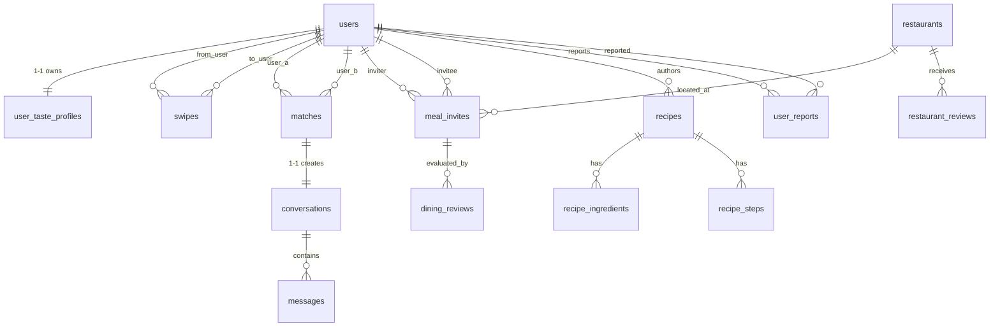

# TÀI LIỆU THIẾT KẾ CƠ SỞ DỮ LIỆU (DATABASE ARCHITECTURE & DESIGN)
## DỰ ÁN: FOODMATE
**Phiên bản:** 1.0  
**Hệ Quản trị CSDL mục tiêu:** PostgreSQL 15+ kết hợp tiện ích Không gian Địa lý PostGIS 3.3+  
**Chuẩn thiết kế:** Chuẩn hóa 3NF/BCNF, Spatial Indexing GiST, JSONB Extensibility, Audit Trail, High Concurrency.

---

## 1. TỔNG QUAN KIẾN TRÚC DỮ LIỆU

Cơ sở dữ liệu FoodMate được thiết kế xoay quanh 4 trục nghiệp vụ cốt lõi:
1. **User & Taste Identity**: Định danh người dùng và ma trận khẩu vị chuyên sâu (Taste Profile).
2. **Matching & Interaction Engine**: Lưu vết tương tác quẹt thẻ (Swipe), ghép đôi (Match) và trò chuyện (Chat).
3. **Dining Conversion (From Match to Table)**: Quản lý cuộc hẹn ngoài đời thực (Meal Invites), xác thực GPS Check-in và chấm điểm uy tín (Trust Score).
4. **Content & Discovery Ecosystem**: Bản đồ địa điểm quán ăn PostGIS và kho công thức nấu ăn do cộng đồng đóng góp.



---

## 2. CÁC QUYẾT ĐỊNH THIẾT KẾ THEN CHỐT (ARCHITECTURAL DECISIONS)

### 2.1 Sử Dụng PostGIS Cho Tọa Độ Địa Lý Thay Vì Lưu Float Lat/Lng
- **Lý do**: Bài toán cốt lõi của FoodMate là: *"Tìm người cùng gu trong bán kính X km"* và *"Gợi ý quán ăn ở điểm trung vị (mid-point) giữa hai người"*, cũng như *"Kiểm tra người dùng có đang đứng cách quán ăn $\le 200$m lúc Check-in hay không"*.
- **Giải pháp**: Sử dụng kiểu dữ liệu `geography(Point, 4326)` (hệ tọa độ WGS 84 tính toán trực tiếp theo mét trên mặt cầu Trái Đất mà không cần quy đổi thủ công).
- **Truy vấn mẫu - Tìm quán ăn quanh người dùng trong bán kính 3 km**:
```sql
SELECT id, name, address_full, avg_rating,
       ROUND((ST_Distance(geo_point, ST_SetSRID(ST_MakePoint(106.7009, 10.7769), 4326)::geography))::numeric, 0) AS distance_meters
FROM restaurants
WHERE ST_DWithin(geo_point, ST_SetSRID(ST_MakePoint(106.7009, 10.7769), 4326)::geography, 3000)
ORDER BY distance_meters ASC
LIMIT 20;
```

### 2.2 Đảm Bảo Tính Bất Biến & Chống Trùng Lặp Cặp Ghép Đôi (`matches`)
- Khi User 1 và User 2 match nhau, nếu không kiểm soát thứ tự lưu trữ, CSDL có thể phát sinh hai bản ghi: `(1, 2)` và `(2, 1)`.
- **Giải pháp**: Áp dụng ràng buộc kiểm tra Check Constraint `chk_user_order CHECK (user_a_id < user_b_id)` và ràng buộc duy nhất `UNIQUE (user_a_id, user_b_id)`. Bất kể ai là người vuốt phải sau cùng, hệ thống luôn tự động sắp xếp `UUID_nhỏ` vào `user_a_id` và `UUID_lớn` vào `user_b_id`.

### 2.3 Quản Lý Khẩu Vị Bằng JSONB Linh Hoạt Kết Hợp Master Data
- Các tiêu chí như danh sách món yêu thích (`cuisines`), dị ứng (`allergies`), khung giờ rảnh (`available_times`) có thể thay đổi hoặc mở rộng trong tương lai.
- Lưu trữ dưới dạng `JSONB` trong PostgreSQL cho phép truy vấn trực tiếp bằng các toán tử chứa `@>`, `?|` và đánh chỉ mục GIN, vừa đảm bảo tốc độ truy vấn vừa không cần tạo thêm 5 bảng phụ trung gian gây suy giảm hiệu năng join.

---

## 3. CHIẾN LƯỢC ĐÁNH CHỈ MỤC & HIỆU NĂNG (INDEXING STRATEGY)

| Tên Chỉ Mục | Bảng | Cột / Biểu Thức | Loại Chỉ Mục | Mục Đích Tối Ưu Hóa |
| :--- | :--- | :--- | :---: | :--- |
| `idx_users_location` | `users` | `last_known_location` | **GiST** | Lọc nhanh ứng viên quanh vị trí hiện tại của người dùng. |
| `idx_restaurants_geo` | `restaurants` | `geo_point` | **GiST** | Tìm kiếm quán ăn gần điểm hẹn và tính khoảng cách check-in. |
| `idx_swipes_from_user` | `swipes` | `(from_user_id, swiped_at DESC)` | **B-Tree** | Đếm số lượt quẹt trong ngày để chặn vượt hạn mức Free (50 lượt). |
| `idx_messages_convo` | `messages` | `(conversation_id, sent_at DESC)` | **B-Tree** | Phân trang tin nhắn trong phòng chat theo thời gian thực. |
| `idx_reports_queue` | `user_reports` | `(status, urgency_level, created_at)` | **Filtered B-Tree** | Hàng đợi xử lý báo cáo vi phạm khẩn cấp cho kiểm duyệt viên. |

---

## 4. CHIẾN LƯỢC SAO LƯU & AN TOÀN DỮ LIỆU (BACKUP & RECOVERY)

1. **Sao lưu hằng ngày (Full Physical Backup)**: Sử dụng pgBackRest / AWS RDS Automated Snapshot sao lưu toàn bộ vào lúc 02:00 sáng hằng ngày, thời gian lưu trữ 30 ngày.
2. **Point-In-Time Recovery (PITR)**: Lưu trữ các tệp Write-Ahead Log (WAL) trên S3/Cloud Storage, cho phép phục hồi dữ liệu về trạng thái chính xác của bất kỳ giây nào trong vòng 14 ngày qua.
3. **Mã hóa dữ liệu tại chỗ (Data at Rest Encryption)**: Ổ đĩa lưu trữ CSDL được kích hoạt mã hóa chuẩn AES-256 (AWS KMS / LUKS).
4. **Tuân thủ Nghị định 13/2023/NĐ-CP**:
   - Trường `last_known_location` chỉ dùng trong session tìm bạn và bị xóa/làm mờ sau 7 ngày không hoạt động.
   - Khi tài khoản yêu cầu xóa (`Status = PendingDeletion`), hệ thống tự động ẩn danh hóa các thông tin nhạy cảm: `full_name = 'Deleted User'`, `phone_number = 'DELETED_' || id`, xóa toàn bộ ảnh trong `avatar_url` và `gallery_json`.
