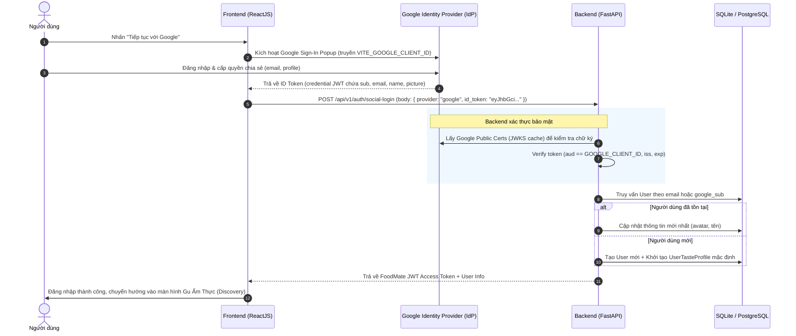

# HƯỚNG DẪN TÍCH HỢP OAUTH 2.0 & HƯỚNG DẪN LẤY OAUTH CLIENT
## DỰ ÁN: FOODMATE
**Phiên bản:** 1.0  
**Ngày phát hành:** 19/10/2026  
**Áp dụng cho:** Frontend (ReactJS/Vite/Mobile), Backend (Python/FastAPI)

---

## 1. TỔNG QUAN KIẾN TRÚC XÁC THỰC OAUTH 2.0 / OPENID CONNECT (OIDC)

### 1.1 Vấn Đề Hiện Tại & Mục Tiêu Nâng Cấp
- **Hiện trạng:** Hệ thống FoodMate có các nút Đăng nhập qua mạng xã hội (Google, Facebook, Apple) nhưng đang sử dụng dữ liệu giả lập (mock `social_id` và thông tin profile gửi từ Client). Cách làm này **không an toàn** trong môi trường Production vì người dùng có thể can thiệp payload gửi lên API để mạo danh tài khoản người khác.
- **Mục tiêu:** Chuyển sang mô hình xác thực tiêu chuẩn **OpenID Connect (OIDC)**:
  1. Người dùng xác thực trên Identity Provider (Google, Meta, Apple).
  2. Identity Provider cấp cho Client một mã định danh bảo mật có chữ ký số cryptographically signed (**ID Token (JWT)** hoặc **Authorization Code**).
  3. Client gửi Token này về Backend FoodMate.
  4. Backend FoodMate dùng **OAuth Client ID & Public Keys** của Provider để giải mã và xác thực chữ ký (Signature Verification). Sau khi hợp lệ, Backend mới tìm hoặc tạo User trong cơ sở dữ liệu và cấp phát JWT Token phiên làm việc của FoodMate.

### 1.2 Sơ Đồ Luồng Xác Thực (Sequence Diagram)



---

## 2. HƯỚNG DẪN CHI TIẾT LẤY OAUTH CLIENT ID & CLIENT SECRET

### 2.1 Google OAuth 2.0 (Google Cloud Console) — *Ưu Tiên Số 1*

#### Bước 1: Tạo dự án mới trên Google Cloud Console
1. Truy cập [Google Cloud Console](https://console.cloud.google.com/).
2. Đăng nhập tài khoản Google của dự án hoặc tài khoản quản trị viên.
3. Ở thanh menu trên cùng, nhấn vào ô chọn dự án (Project dropdown) -> Chọn **New Project** (Dự án mới).
4. Đặt tên dự án: `FoodMate-Production` (hoặc `FoodMate-Dev` cho môi trường thử nghiệm).
5. Nhấn **Create** và chờ vài giây để hệ thống khởi tạo.

#### Bước 2: Cấu hình Màn hình đồng thuận OAuth (OAuth Consent Screen)
Trước khi tạo Client ID, Google bắt buộc phải cấu hình Consent Screen:
1. Vào menu bên trái: **APIs & Services** -> **OAuth consent screen**.
2. Chọn loại đối tượng người dùng (**User Type**):
   - Chọn **External** (Bên ngoài): Cho phép bất kỳ ai có tài khoản Google (@gmail.com hoặc Google Workspace) đăng nhập vào FoodMate.
   - Nhấn **Create**.
3. Điền thông tin ứng dụng (**App information**):
   - **App name**: `FoodMate`
   - **User support email**: Email quản trị viên (ví dụ: `support@foodmate.vn` hoặc gmail cá nhân).
   - **App logo**: Tải logo nhận diện 120x120px của FoodMate (tùy chọn).
   - **Application home page**: `https://foodmate.vn` (hoặc `http://localhost:5173` khi test).
   - **Authorized domains**: Nhập tên miền chính thức: `foodmate.vn` (khi deploy production).
   - **Developer contact information**: Nhập email lập trình viên kỹ thuật.
   - Nhấn **Save and Continue**.
4. Cấu hình Phạm vi quyền truy cập (**Scopes**):
   - Nhấn **Add or Remove Scopes**.
   - Chọn 3 scopes cơ bản nhất (thuộc nhóm Non-sensitive scopes):
     - `.../auth/userinfo.email` (Xem địa chỉ email chính)
     - `.../auth/userinfo.profile` (Xem thông tin cá nhân cơ bản: họ tên, ảnh đại diện)
     - `openid` (Xác thực OpenID Connect)
   - Nhấn **Update** -> **Save and Continue**.
5. Thêm người dùng thử nghiệm (**Test users** - Nếu ứng dụng ở trạng thái Testing):
   - Thêm các email dùng để test thử nghiệm nội bộ.
   - Nhấn **Save and Continue** -> **Back to Dashboard**.

#### Bước 3: Tạo OAuth Client ID
1. Vào menu bên trái: **APIs & Services** -> **Credentials**.
2. Nhấn nút **+ CREATE CREDENTIALS** ở trên cùng -> Chọn **OAuth client ID**.
3. Chọn **Application type**: **Web application**.
4. Đặt tên Client: `FoodMate Web Client`.
5. Cấu hình **Authorized JavaScript origins** (Nguồn gốc JavaScript được phép):
   - Thêm URL môi trường Local Development:
     - `http://localhost:5173`
     - `http://127.0.0.1:5173`
   - Thêm URL môi trường Production/Staging:
     - `https://foodmate.vn`
     - `https://app.foodmate.vn`
   > *Lưu ý quan trọng:* Không được có dấu gạch chéo `/` ở cuối URL origin.
6. Cấu hình **Authorized redirect URIs** (URI chuyển hướng được cấp phép):
   - `http://localhost:5173`
   - `http://localhost:5173/auth/callback`
   - `https://foodmate.vn/auth/callback`
7. Nhấn **Create**.
8. Một cửa sổ popup hiện ra chứa:
   - **Your Client ID**: Có định dạng dạng: `xxxxxxxxxxxx-xxxxxxxxxxxxxxxxxxxxxxxxxxxxxxxx.apps.googleusercontent.com`
   - **Your Client Secret**: Dạng chuỗi bí mật: `GOCSPX-xxxxxxxxxxxxxxxxxxxxxxxx`
9. **Lưu trữ**:
   - Sao chép `Client ID` gán vào biến môi trường Frontend và Backend.
   - Sao chép `Client Secret` lưu vào biến môi trường bảo mật phía Backend (Tuyệt đối không để lộ Client Secret ra phía Frontend!).

*(Tùy chọn: Nếu sau này phát triển Flutter/React Native App)*:
- Tạo thêm Credentials -> **Android Client ID** (Cần Package Name: `com.foodmate.app` và SHA-1 Signing Certificate Fingerprint).
- Tạo thêm Credentials -> **iOS Client ID** (Cần Bundle ID: `vn.foodmate.ios`).

---

### 2.2 Facebook Login (Meta for Developers)

1. Truy cập [Meta for Developers](https://developers.facebook.com/) -> Đăng nhập và chọn **My Apps** -> **Create App**.
2. Chọn trường hợp sử dụng: **Authenticate and request data from users with Facebook Login**.
3. Đặt tên ứng dụng: `FoodMate`.
4. Điền email liên hệ của quản trị viên -> Nhấn **Create app**.
5. Trong giao diện Dashboard ứng dụng:
   - Tìm mục **Facebook Login** -> Nhấn **Set Up**.
   - Chọn nền tảng: **Web**.
   - Cài đặt cấu hình: Vào mục **Facebook Login** -> **Settings**:
     - Bật: **Client OAuth Login**, **Web OAuth Login**, **Enforce HTTPS**.
     - **Valid OAuth Redirect URIs**:
       - `http://localhost:5173/`
       - `https://foodmate.vn/`
   - Vào mục **App settings** -> **Basic**:
     - Lấy **App ID** (đóng vai trò Client ID).
     - Lấy **App Secret** (Client Secret).
     - Điền Privacy Policy URL và Terms of Service URL (theo yêu cầu bắt buộc của Meta khi kích hoạt chế độ Live).

---

### 2.3 Sign in with Apple (Apple Developer Program)

1. Đăng nhập [Apple Developer Account](https://developer.apple.com/account/).
2. Vào **Certificates, Identifiers & Profiles**:
   - **Identifiers**: Tạo **App ID** (ví dụ `vn.foodmate.client`) và bật capability **Sign In with Apple**.
   - Tạo **Services ID** (dùng cho Web Login, ví dụ `vn.foodmate.web.auth`):
     - Bật Sign In with Apple -> Configure:
     - Nhập Primary App ID.
     - **Domains and Subdomains**: `foodmate.vn`.
     - **Return URLs**: `https://foodmate.vn/api/v1/auth/apple/callback`.
3. **Keys**: Tạo một Private Key mới cho Sign In with Apple:
   - Tải file `.p8` (chỉ tải được duy nhất 1 lần).
   - Lưu trữ `Key ID` và `Team ID`.
   - Client Secret của Apple được tạo động bằng cách ký một JWT token bằng file khóa bí mật `.p8` (thời hạn tối đa 6 tháng).

---

## 3. HƯỚNG DẪN TÍCH HỢP VÀO FRONTEND (REACTJS + VITE)

### 3.1 Cài Đặt Thư Viện Chuẩn
Sử dụng thư viện chính thức của Google Identity Services dành cho React:

```bash
cd frontend
npm install @react-oauth/google jwt-decode
```

### 3.2 Cấu Hình Biến Môi Trường Frontend
Tạo file `frontend/.env` (tham khảo `frontend/.env.example`):

```ini
# API Base URL
VITE_API_BASE_URL=http://127.0.0.1:8000/api/v1

# Google OAuth Client ID (Lấy từ Google Cloud Console)
VITE_GOOGLE_CLIENT_ID=xxxxxxxxxxxx-xxxxxxxxxxxxxxxxxxxxxxxxxxxxxxxx.apps.googleusercontent.com
```

### 3.3 Bọc Ứng Dụng với `GoogleOAuthProvider`
Trong file `frontend/src/main.jsx`:

```jsx
import React from 'react';
import ReactDOM from 'react-dom/client';
import App from './App.jsx';
import './index.css';
import { GoogleOAuthProvider } from '@react-oauth/google';

const GOOGLE_CLIENT_ID = import.meta.env.VITE_GOOGLE_CLIENT_ID || '';

ReactDOM.createRoot(document.getElementById('root')).render(
  <React.StrictMode>
    <GoogleOAuthProvider clientId={GOOGLE_CLIENT_ID}>
      <App />
    </GoogleOAuthProvider>
  </React.StrictMode>,
);
```

### 3.4 Tích Hợp Google Sign-In Trong `AuthView.jsx`

Thay thế phương thức mock bằng phương thức tiếp nhận `id_token` thực tế từ Google:

```jsx
import { useGoogleLogin } from '@react-oauth/google';
import api from '../services/api';

// Bên trong component AuthView:
const loginWithGoogle = useGoogleLogin({
  onSuccess: async (tokenResponse) => {
    setLoading(true);
    setErrorMsg('');
    try {
      // Cách 1: Nếu dùng Implicit/Code flow trả về access_token hoặc id_token
      // Gửi token xác thực về backend để verify chữ ký
      const res = await api.socialLogin('google', {
        idToken: tokenResponse.access_token || tokenResponse.id_token,
        provider: 'google'
      });

      if (res && res.data && res.data.user) {
        onAuthSuccess(res.data.user);
      }
    } catch (err) {
      console.error('Lỗi đăng nhập Google:', err);
      setErrorMsg(err.message || 'Đăng nhập Google thất bại');
    } finally {
      setLoading(false);
    }
  },
  onError: () => {
    setErrorMsg('Xác thực với tài khoản Google không thành công.');
  }
});
```

Hoặc sử dụng component `GoogleLogin` có sẵn của thư viện (hỗ trợ One-Tap và tự động trả về ID Token JWT):

```jsx
import { GoogleLogin } from '@react-oauth/google';

<GoogleLogin
  onSuccess={async (credentialResponse) => {
    // credentialResponse.credential chính là Google ID Token (JWT)
    const res = await api.socialLogin('google', {
      idToken: credentialResponse.credential,
      provider: 'google'
    });
    if (res?.data?.user) {
      onAuthSuccess(res.data.user);
    }
  }}
  onError={() => {
    setErrorMsg('Đăng nhập Google thất bại');
  }}
  useOneTap
  theme="outline"
  shape="pill"
  text="continue_with"
/>
```

---

## 4. HƯỚNG DẪN TÍCH HỢP & XÁC THỰC PHÍA BACKEND (FASTAPI)

### 4.1 Cài Đặt Thư Viện Phía Backend
Cài đặt SDK chính thức của Google để xác minh ID Token:

```bash
cd backend
pip install google-auth requests
```

Thêm vào `backend/requirements.txt`:
```txt
google-auth>=2.28.0
requests>=2.31.0
```

### 4.2 Cấu Hình Biến Môi Trường Backend
Tạo file `backend/.env` (tham khảo `backend/.env.example`):

```ini
# Cấu hình máy chủ
ENV=development
PORT=8000

# Google OAuth
GOOGLE_CLIENT_ID=xxxxxxxxxxxx-xxxxxxxxxxxxxxxxxxxxxxxxxxxxxxxx.apps.googleusercontent.com
GOOGLE_CLIENT_SECRET=GOCSPX-xxxxxxxxxxxxxxxxxxxxxxxx

# JWT Secret cho phiên làm việc FoodMate
JWT_SECRET_KEY=foodmate_super_secret_jwt_key_2026
JWT_ALGORITHM=HS256
ACCESS_TOKEN_EXPIRE_MINUTES=43200
```

### 4.3 Cập Nhật Schema `SocialLoginRequest`
Trong `backend/app/schemas.py`:

```python
class SocialLoginRequest(BaseModel):
    provider: str = Field(..., example="google")  # 'google', 'facebook', 'apple'
    id_token: Optional[str] = Field(None, description="Google ID Token (JWT) hoặc OAuth Access Token")
    # Cho phép fallback trong môi trường dev test
    full_name: Optional[str] = None
    email: Optional[str] = None
    avatar_url: Optional[str] = None
    social_id: Optional[str] = None
```

### 4.4 Cập Nhật Hàm Xử Lý Endpoint `/api/v1/auth/social-login`
Trong `backend/app/routers/auth.py`:

```python
import os
from google.oauth2 import id_token
from google.auth.transport import requests as google_requests
from fastapi import HTTPException, status

GOOGLE_CLIENT_ID = os.getenv("GOOGLE_CLIENT_ID", "")

@router.post("/social-login")
def social_login(req: SocialLoginRequest, db: Session = Depends(get_db)):
    """
    Đăng nhập hoặc đăng ký an toàn bằng Google ID Token / OAuth2 Provider.
    """
    social_id = None
    email = None
    full_name = None
    avatar_url = None

    # 1. Xác thực ID Token nếu provider là Google
    if req.provider == "google" and req.id_token:
        try:
            # Xác thực chữ ký số và hạn sử dụng trực tiếp với Google Public Keys
            id_info = id_token.verify_oauth2_token(
                req.id_token,
                google_requests.Request(),
                GOOGLE_CLIENT_ID if GOOGLE_CLIENT_ID else None
            )

            # Trích xuất thông tin an toàn từ Google claims
            social_id = id_info.get("sub")
            email = id_info.get("email")
            full_name = id_info.get("name")
            avatar_url = id_info.get("picture")

        except ValueError as e:
            # Token không hợp lệ hoặc hết hạn
            raise HTTPException(
                status_code=status.HTTP_401_UNAUTHORIZED,
                detail=f"Google ID Token không hợp lệ: {str(e)}"
            )
    else:
        # Fallback môi trường development mock test
        social_id = req.social_id or f"test_{uuid.uuid4().hex[:6]}"
        full_name = req.full_name or f"User {req.provider.capitalize()}"
        avatar_url = req.avatar_url or DEFAULT_AVATARS[0]
        email = req.email

    # 2. Tìm User trong cơ sở dữ liệu (qua SĐT ảo gắn với Social ID hoặc Email)
    identifier_phone = f"+84_{req.provider}_{social_id[:12]}"
    user = db.query(User).filter(User.phone_number == identifier_phone).first()

    # 3. Tạo mới người dùng nếu chưa có
    if not user:
        user = User(
            id=f"user-{req.provider}-{uuid.uuid4().hex[:6]}",
            phone_number=identifier_phone,
            full_name=full_name or "Thành viên FoodMate",
            gender="other",
            avatar_url=avatar_url or DEFAULT_AVATARS[0],
            occupation=f"Tài khoản {req.provider.capitalize()}",
            bio=f"Chào mọi người! Mình đăng nhập bằng {req.provider.capitalize()} và mong muốn tìm bạn cùng gu ăn uống.",
            role="member",
            is_verified=True,  # Đã xác thực qua Google/Facebook
            trust_score=100,
            latitude=10.7769,
            longitude=106.7009
        )
        db.add(user)
        db.commit()
        db.refresh(user)

        # Khởi tạo Hồ sơ khẩu vị (Taste Profile) ban đầu
        taste = UserTasteProfile(
            user_id=user.id,
            cuisines_json=json.dumps(["VN_TRAD", "HOTPOT"]),
            spicy_level=2,
            budget_tier="BUDGET_T2",
            connection_purpose="food_buddy",
            favorite_dish="Ẩm thực Việt & Lẩu",
            max_distance_km=10
        )
        db.add(taste)
        db.commit()

    taste = user.taste_profile

    # 4. Trả về JWT Access Token của hệ thống FoodMate
    return {
        "success": True,
        "message": f"Đăng nhập qua {req.provider.capitalize()} thành công!",
        "data": {
            "access_token": f"token_foodmate_{user.id}",
            "token_type": "Bearer",
            "user": {
                "id": user.id,
                "phone_number": user.phone_number,
                "full_name": user.full_name,
                "email": email,
                "avatar_url": user.avatar_url,
                "role": user.role,
                "is_verified": user.is_verified,
                "trust_score": user.trust_score,
                "taste_profile": {
                    "cuisines": taste.cuisines if taste else ["VN_TRAD"],
                    "spicy_level": taste.spicy_level if taste else 2,
                    "budget_tier": taste.budget_tier if taste else "BUDGET_T2",
                    "favorite_dish": taste.favorite_dish if taste else "",
                    "connection_purpose": taste.connection_purpose if taste else "food_buddy",
                    "max_distance_km": taste.max_distance_km if taste else 10
                }
            }
        }
    }
```

---

## 5. TỔNG HỢP CÁC LỖI THƯỜNG GẶP & CÁCH KHẮC PHỤC (TROUBLESHOOTING)

| STT | Lỗi Thường Gặp | Nguyên Nhân | Cách Khắc Phục |
|:---:|:---|:---|:---|
| 1 | `redirect_uri_mismatch` (400) | URL redirect trong request không khớp 100% với cấu hình trên Google Cloud Console | Kiểm tra lại port, giao thức `http` vs `https`, loại bỏ dấu gạch chéo `/` ở cuối URL origin trên Console. |
| 2 | `idpiframe_initialization_failed` | Trình duyệt chặn 3rd-party cookies hoặc tên miền chưa nằm trong Authorized JavaScript origins | Cho phép cookie bên thứ 3 trong cài đặt bảo mật trình duyệt, hoặc thêm đúng domain chạy web vào GCP Console. |
| 3 | `Token used too early or too late` | Lệch đồng hồ thời gian hệ thống giữa máy chủ Backend và Google NTP Servers | Đồng bộ lại thời gian hệ thống (`sudo sntp -sS time.google.com` hoặc cấu hình timezone NTP tự động). |
| 4 | `Invalid Value (audience)` | Client ID truyền vào Backend để verify khác với Client ID mà Frontend dùng để lấy token | Đảm bảo biến `VITE_GOOGLE_CLIENT_ID` (Frontend) và `GOOGLE_CLIENT_ID` (Backend) cùng dùng chung một giá trị. |
| 5 | `Cross-Origin-Opener-Policy policy` | Trình duyệt chặn cửa sổ popup đăng nhập của Google do chính sách bảo mật COOP/COEP | Thêm header `Cross-Origin-Opener-Policy: same-origin-allow-popups` trong cấu hình máy chủ Web hoặc Vite dev server. |

---

## 6. DANH MỤC BIẾN MÔI TRƯỜNG CẦN THIẾT

### Frontend (`frontend/.env`)
```ini
VITE_API_BASE_URL=http://127.0.0.1:8000/api/v1
VITE_GOOGLE_CLIENT_ID=YOUR_GOOGLE_CLIENT_ID_HERE.apps.googleusercontent.com
```

### Backend (`backend/.env`)
```ini
ENV=development
PORT=8000
GOOGLE_CLIENT_ID=YOUR_GOOGLE_CLIENT_ID_HERE.apps.googleusercontent.com
GOOGLE_CLIENT_SECRET=YOUR_GOOGLE_CLIENT_SECRET_HERE
JWT_SECRET_KEY=foodmate_secret_key_change_me_in_production
```
