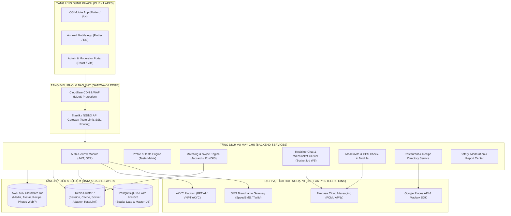

# TÀI LIỆU THIẾT KẾ KIẾN TRÚC KỸ THUẬT (TECHNICAL ARCHITECTURE DOCUMENT)
## DỰ ÁN: FOODMATE
**Phiên bản:** 1.0  
**Tác giả:** Technical Architect & Engineering Team  
**Ngày phát hành:** 16/10/2026  

---

## 1. TỔNG QUAN HỆ THỐNG & SƠ ĐỒ KIẾN TRÚC (HIGH-LEVEL ARCHITECTURE)

Hệ thống FoodMate được xây dựng theo mô hình **Modular Monolith hướng Microservices-ready**, cân bằng tối ưu giữa tốc độ phát triển giai đoạn MVP và khả năng mở rộng quy mô ngang (Horizontal Scaling) lên hàng trăm nghìn người dùng.

---

## 2. LỰA CHỌN CÔNG NGHỆ & ĐÁNH GIÁ (TECH STACK JUSTIFICATION)

### 2.1 Ứng Dụng Di Động (Mobile Client)
- **Công nghệ đề xuất**: **Flutter (Google Dart)** hoặc **React Native**.
- **Lý do lựa chọn**:
  - Viết một lần (Single Codebase), biên dịch mã gốc hiệu năng cao cho cả iOS và Android, giúp tiết kiệm 45% chi phí phát triển và đảm bảo tính nhất quán của thuật toán render giao diện quẹt thẻ.
  - Thư viện quản lý cử chỉ kéo vuốt mượt mà (60–120 FPS) tương tự Tinder.
  - Hỗ trợ tốt các thư viện bản đồ tương tác (Mapbox GL / Google Maps Flutter) và truy xuất phần cứng thiết bị (GPS định vị nền, Camera trực tiếp cho eKYC, Lưu trữ Keychain/Keystore mã hóa).

### 2.2 Nền Tảng Máy Chủ (Backend Core)
- **Công nghệ đề xuất**: **Node.js (NestJS - TypeScript)** hoặc **Java (Spring Boot 3.x)**.
  - *Lựa chọn ưu tiên cho MVP*: **NestJS**.
- **Lý do lựa chọn**:
  - Kiến trúc Module hóa chặt chẽ (Clean Architecture / Dependency Injection), dễ bảo trì và mở rộng.
  - Xử lý bất đồng bộ non-blocking I/O vượt trội đối với các tác vụ I/O nặng (quẹt thẻ hàng nghìn lượt/phút, push notification, tra cứu PostGIS).
  - Tích hợp mượt mà cơ chế WebSocket phục vụ phòng chat thời gian thực và quản lý phòng chat qua Redis Streams.

### 2.3 Cơ Sở Dữ Liệu & Bộ Đệm (Database & Caching)
- **Cơ sở dữ liệu chính**: **PostgreSQL 15+** mở rộng với extension **PostGIS**.
  - Đóng vai trò là nguồn chân lý dữ liệu (Source of Truth), xử lý ACID toàn vẹn cho các mối quan hệ phức tạp giữa người dùng, cặp ghép đôi và cuộc hẹn đi ăn.
  - Khả năng xử lý hình học không gian địa lý (GIS) chuẩn công nghiệp: Tính bán kính, điểm giao, khoảng cách chính xác theo hệ WGS-84.
- **Bộ đệm & Điều phối (Cache & In-Memory Data Store)**: **Redis 7**.
  - Lưu trữ tạm thời danh sách ID đã quẹt trong ngày (`Set` data structure) để kiểm tra chặn quẹt trùng chỉ trong $\approx 1\text{ ms}$.
  - Quản lý bộ đếm lượt quẹt hàng ngày (Rate limiting `INCR` với TTL 24h).
  - Làm adapter kết nối WebSocket Cluster phân tán (Socket.io Redis Pub/Sub Adapter).

### 2.4 Lưu Trữ & Xử Lý Đa Phương Tiện (Media & Object Storage)
- **Lưu trữ**: **AWS S3** hoặc **Cloudflare R2** (không tính phí egress băng thông tải xuống).
- **Quy trình nén ảnh tự động**: Toàn bộ ảnh đại diện, ảnh bài đăng ẩm thực sau khi tải lên sẽ đi qua một hàng đợi xử lý ảnh không đồng bộ (AWS Lambda / BullMQ Worker) sử dụng thư viện `sharp` để chuyển đổi tự động sang chuẩn **WebP** với độ nén tối ưu (giảm 60–75% dung lượng so với JPEG/PNG gốc mà không suy giảm chất lượng hiển thị).

---

## 3. CHIẾN LƯỢC BẢO MẬT & TUÂN THỦ PHÁP LÝ (SECURITY & COMPLIANCE)

### 3.1 Tuân Thủ Nghị Định 13/2023/NĐ-CP Về Bảo Vệ Dữ Liệu Cá Nhân
1. **Thu thập tối thiểu & Có sự đồng thuận (Explicit Consent)**: Mọi dữ liệu vị trí GPS, thông tin eKYC và số điện thoại đều phải có màn hình thông báo rõ ràng cho người dùng trước khi cấp quyền.
2. **Ẩn danh hóa vị trí (Location Obfuscation Pattern)**:
   - Hệ thống tuyệt đối không lưu vết đường đi (tracking trace) liên tục của người dùng.
   - Vị trí chỉ được cập nhật khi người dùng mở tab Khám phá hoặc thực hiện Check-in tại quán.
   - Không bao giờ trả về vĩ độ/kinh độ chính xác của người dùng khác qua API; API chỉ trả về thuộc tính `distance_km` đã làm tròn một chữ số thập phân (hoặc làm tròn ngẫu nhiên $\pm 200\text{m}$).
3. **Quyền được quên (Right to be Forgotten)**: Quy trình xóa tài khoản tự động làm sạch (wipe out) toàn bộ thông tin nhạy cảm trong CSDL sau 30 ngày.

### 3.2 Chiến Lược Bảo Vệ Khỏi Tấn Công Mạng
- **Chống Tấn Công Từ Chối Dịch Vụ (DDoS & Brute-force)**: Sử dụng Cloudflare WAF chặn các IP bất thường; triển khai Rate Limiting trên API Gateway (tối đa 5 request gửi OTP trong 10 phút trên cùng một số điện thoại).
- **Bảo Vệ Khỏi OWASP Top 10**:
  - Chống SQL Injection bằng cách sử dụng 100% Prepared Statements / ORM TypeORM/Prisma.
  - Chống XSS bằng việc khử khuẩn mã độc (Sanitization) toàn bộ văn bản chat và bài đăng công thức.
  - Thiết lập Header bảo mật: `Content-Security-Policy`, `X-Frame-Options: DENY`, `Strict-Transport-Security`.

---

## 4. CHIẾN LƯỢC TRIỂN KHAI & CI/CD (DEVOPS & DEPLOYMENT)

### 4.1 Mô Hình Đóng Gói (Containerization)
Toàn bộ mã nguồn Backend và Admin Web được đóng gói bằng **Docker** (Multi-stage build) để tối ưu kích thước image (< 150MB cho Node.js production image).

### 4.2 Đường Ống CI/CD (GitHub Actions Workflow)
1. **Kiểm tra tự động (Lint & Test)**: Tự động chạy ESlint, Prettier, Unit Tests và Integration Tests mỗi khi tạo Pull Request vào nhánh `develop` hoặc `main`.
2. **Quét bảo mật mã nguồn (Security Audit)**: Quét phụ thuộc (Dependency vulnerabilities scan) bằng Snyk / Trivy.
3. **Triển khai tự động (Continuous Deployment)**:
   - Nhánh `develop` $\rightarrow$ Tự động build và deploy lên máy chủ Staging.
   - Nhánh `main` $\rightarrow$ Tự động tạo bản phát hành (Release tag), build Docker image đẩy lên AWS ECR và thực hiện Rolling Update trên máy chủ Production (Zero-downtime deployment).

### 4.3 Giám Sát Vận Hành (Observability & Monitoring)
- **Giám sát hiệu năng ứng dụng (APM)**: Sử dụng Sentry để bắt lỗi và crash thời gian thực trên cả ứng dụng di động và backend.
- **Thu thập chỉ số & Bảng điều khiển (Metrics & Dashboards)**: Prometheus thu thập các chỉ số CPU, RAM, thời gian phản hồi API p95, số kết nối WebSocket active; Grafana hiển thị trực quan.
- **Quản lý nhật ký tập trung (Centralized Logging)**: Triển khai Loki / ELK Stack thu thập log có cấu trúc (JSON Format) gắn kèm `CorrelationId` cho mỗi request.
